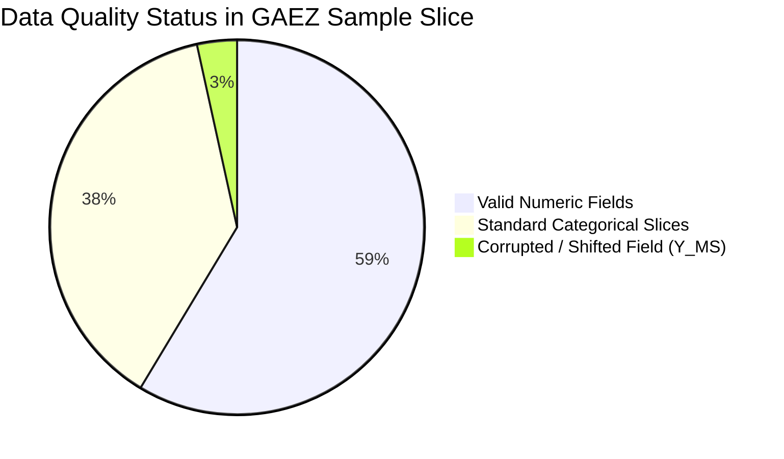
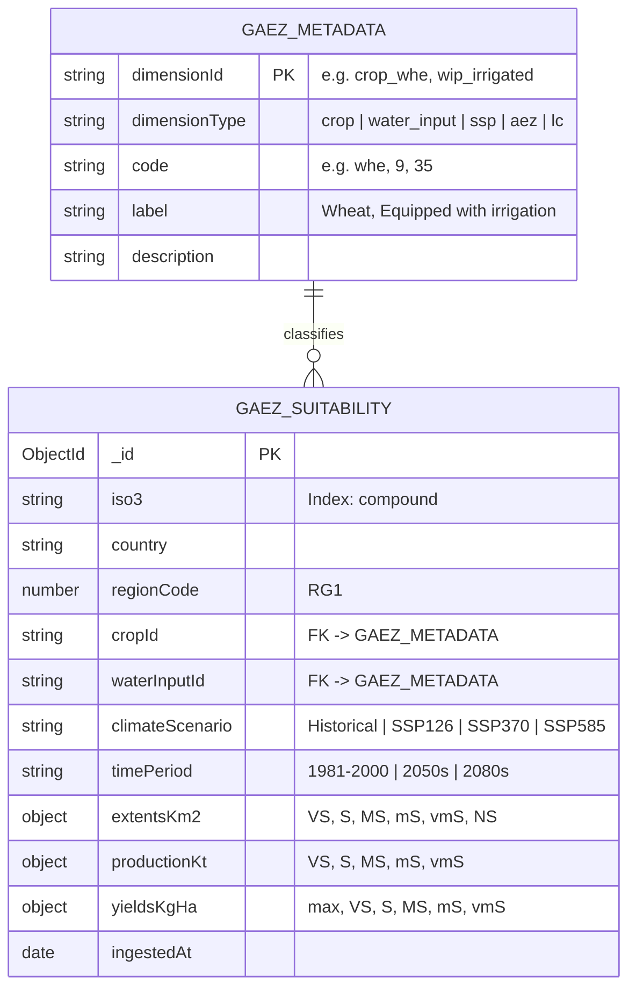
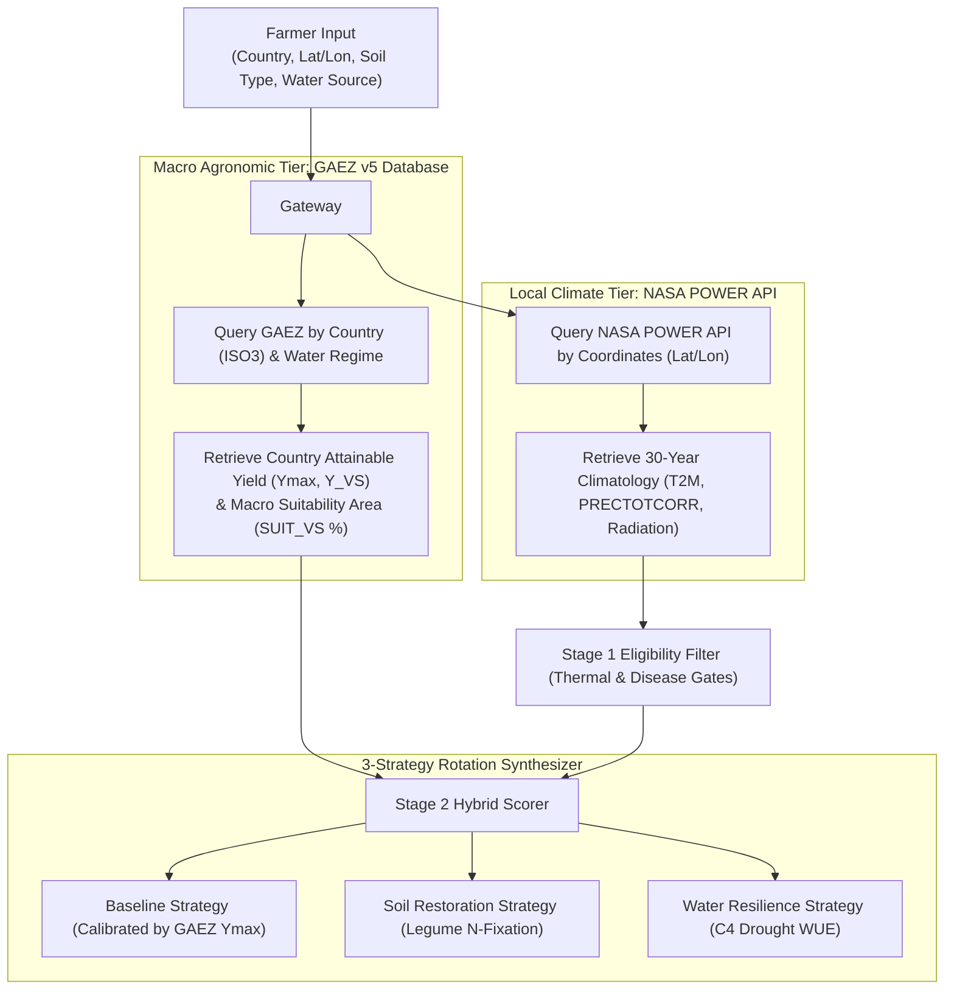

# GAEZ Dataset Deep Inspection & Technical Audit Report 🌾🛰️
**Platform:** AgriShift — Global Agricultural Intelligence & Explainable Crop Rotation Platform  
**Target Event:** NASA Space Apps Challenge 2026  
**Auditor:** Senior Full-Stack Software Architect, NASA Earth Observation Specialist & AI Recommendation Systems Engineer  
**Date of Audit:** November 14, 2026  
**Document Location:** `dataset/reports/GAEZ_DATASET_AUDIT.md`  

---

## Executive Summary

This report delivers a rigorous, file-by-file forensic inspection of the FAO/IIASA **Global Agro-Ecological Zones version 5 (GAEZ v5)** dataset files supplied to the **AgriShift** project in `docs/dataset/` and mirrored to `dataset/raw/`. 

The dataset provides critical global agronomic baselines detailing agro-climatic crop suitability extents ($km^2$), potential production ($10^3\text{ tons}$), and attainable yields ($kg/ha$) across 178 sovereign nations and territories. When combined with live satellite agroclimatology from the **NASA Langley Research Center POWER Project**, GAEZ v5 provides the macro-regional agronomic ceiling required by AgriShift's two-stage hybrid recommendation engine.

---

## 1. Dataset Inventory

| File Name | Location Path | File Format | File Size | Primary Purpose & Nature | Contains Agricultural Data? |
| :--- | :--- | :--- | :--- | :--- | :--- |
| **`gaez-sample.csv`** | `docs/dataset/` & `dataset/raw/` | Delimited Text (CSV, UTF-8) | 49,401 bytes (48.2 KB) | Empirical country-level crop suitability, potential production, and attainable yield records | **Yes** (178 agricultural country records) |
| **`gaezv5_cropsummarydata_readme.xlsx`** | `docs/dataset/` & `dataset/raw/` | Microsoft Excel OpenXML Spreadsheet (`.xlsx`) | 22,971 bytes (22.4 KB) | Official FAO/IIASA technical metadata, domain classifications, land cover, AEZ classes, and variable dictionary | **No** (Strictly metadata and coding dictionaries) |

---

## 2. File-by-File Technical Inspection

### 2.1 `gaez-sample.csv`
- **Total Rows (excluding header)**: `178` records
- **Total Columns**: `29` columns
- **Encoding**: UTF-8 without BOM
- **Line Endings**: CRLF (`\r\n`)
- **Header Structure**:
  `iso3,RG1,country,LC,EXC,AEZ,Crop,climate_data_source,ssp,time_period,water_input,geographic_level,SUIT_VS,SUIT_S,SUIT_MS,SUIT_mS_,SUIT_vmS_,SUIT_NS,PROD_VS,PROD_S,PROD_MS,PROD_mS_,PROD_vmS_,Ymax,Y_VS,Y_S,Y_MS,Y_mS_,Y_vmS_`
- **Slice Characteristics**:
  This dataset is a country-level aggregation extracted from GAEZ v5 representing:
  - **Crop**: Wheat (`Crop = "Wheat"`)
  - **Water & Input Regime**: Irrigated with high management input (`water_input = "Irrigation and high input level of management"`)
  - **Climate Model / Baseline**: AgERA5 reanalysis (`climate_data_source = "AgERA5"`)
  - **Climate Scenario**: Historical (`ssp = "Historical"`)
  - **Time Window**: 1981–2000 climatological normal (`time_period = "1981-2000"`)
  - **Land Cover Class**: Cropland equipped with irrigation (`LC = "Cropland, equipped with irrigation"`, Code 9)
  - **Exclusion Class**: Total Land (`EXC = "Total land"`, Code 5)
  - **Agro-Ecological Zone**: Total Land (`AEZ = "Total land"`, Code 35)
  - **Geographic Level**: Sovereign Country totals (`geographic_level = "Country"`)

### 2.2 `gaezv5_cropsummarydata_readme.xlsx`
The metadata file consists of two internal worksheets:
- **Sheet 1: `README`** (46 rows):
  - Defines the 11 Land Cover (`LC`) classes (e.g., Code 1: Cropland, Code 8: Cropland rain-fed, Code 9: Cropland equipped with irrigation, Code 11: Total land).
  - Defines the 5 Exclusion (`EXC`) classes (e.g., Code 1: No protection, Code 2: WDPA protected areas, Code 5: Total land).
  - Defines the 35 Agro-Ecological Zones (`AEZ`) classes (Codes 1–6: Tropics; Codes 7–15: Sub-tropics; Codes 16–21: Temperate; Codes 22–24: Cold; Codes 25–33: Terrain/Soil limitations; Code 35: Total land).
  - Provides critical operational footnotes:
    - *Footnote 3*: Yield and production values are reported in dry weight (kg/ha and 1,000 metric tons).
    - *Footnote 4*: Country total filters require `EXC = 5` and `AEZ = 35`.
    - *Footnote 5*: Land categorized as marginally suitable (`mS`), very marginally suitable (`vmS`), or not suitable (`NS`) is generally not economically viable for commercial farming.
    - *Footnote 6*: Potential production incorporates land fallow requirements: $\text{Potential Production} = \text{Area} \times \text{Yield} \times (1 - \text{fallow factor})$.
- **Sheet 2: `Variables`** (26 rows):
  - Explicitly documents domain groupings: `LAND UNITS` (columns 0–6), `LAND AREA` (column extents), `SUITABILITY CLASSES` (columns 12–17), `POTENTIAL PRODUCTION` (columns 18–22), and `POTENTIAL YIELD` (columns 23–28).

---

## 3. GAEZ Schema Dimensions & Dimension Mapping

The FAO/IIASA GAEZ Summary Tables API and data cube are structured along 10 fundamental metadata dimensions:

```mermaid
flowchart TD
    subgraph GAEZ_Dimensions ["GAEZ Dimensional Cube"]
        GL["gl: Geographic Level\n(Global, Regional, Country)"]
        CTR["country: Sovereign State\n(ISO3 / Regional Grouping)"]
        CRP["crop: Crop Species\n(Wheat, Maize, Rice, etc.)"]
        WIP["wip: Water Input Regime\n(Rain-fed, Irrigated, High/Low Inputs)"]
        TMP["tmp: Time Period\n(1981-2000, 2020s, 2050s, 2080s)"]
        CDS["cds: Climate Data Source\n(AgERA5, HadGEM, MPI-ESM, etc.)"]
        SSP["ssp: Climate Scenario\n(Historical, SSP126, SSP370, SSP585)"]
        LC["lc: Land Cover Class\n(Codes 1 - 11)"]
        EXC["exc: Exclusion Class\n(Codes 1 - 5)"]
        AEZ["aez: Agro-Ecological Zone\n(Codes 1 - 35)"]
    end

    subgraph CSV_Columns ["Sample CSV Ingestion Columns"]
        GL --> C_gl["geographic_level"]
        CTR --> C_iso["iso3, RG1, country"]
        CRP --> C_crp["Crop, Y_MS (misplaced 'whe')"]
        WIP --> C_wip["water_input"]
        TMP --> C_tmp["time_period"]
        CDS --> C_cds["climate_data_source"]
        SSP --> C_ssp["ssp"]
        LC --> C_lc["LC"]
        EXC --> C_exc["EXC"]
        AEZ --> C_aez["AEZ"]
    end
```



### Dimension Correspondence Matrix

| Dimension Code | GAEZ Technical Dimension | Name in `gaez-sample.csv` | Value in Sample Slice | Full GAEZ Available Domain |
| :--- | :--- | :--- | :--- | :--- |
| **`gl`** | Geographic Level | `geographic_level` | `Country` | Global, Regional, Country, Sub-national |
| **`country`**| Sovereign Country | `country` & `iso3` | 178 countries (USA, IND, CHN, PAK, etc.) | ~240 countries and territories |
| **`crop`** | Crop Identifier | `Crop` (and acronym in col 26) | `Wheat` (`whe`) | ~52 agricultural crops & pasture species |
| **`wip`** | Water Input Level | `water_input` | `Irrigation and high input level of management` | Rain-fed (Low/Med/High), Irrigated (High) |
| **`tmp`** | Time Horizon | `time_period` | `1981-2000` | 1981–2010, 2011–2040, 2041–2070, 2071–2100 |
| **`cds`** | Climate Data Source | `climate_data_source` | `AgERA5` | AgERA5, UKESM1, GFDL-ESM4, IPSL-CM6A-LR, MPI-ESM1-2-HR, MRI-ESM2-0 |
| **`ssp`** | Climate Forcing Pathway | `ssp` | `Historical` | Historical, SSP126, SSP370, SSP585 |
| **`lc`** | Land Cover Baseline | `LC` | `Cropland, equipped with irrigation` | 11 classes (Total land, Cropland, Forest, etc.) |
| **`exc`** | Environmental Protection | `EXC` | `Total land` | 5 classes (WDPA protected, Wetlands, Forest, Total) |
| **`aez`** | Agro-Ecological Zone | `AEZ` | `Total land` | 35 classes (Tropical, Sub-tropical, Temperate, Cold) |

---

## 4. Comprehensive Column Dictionary

| Column Index | Column Header | Data Type | Units / Range | Agricultural Meaning & Interpretation |
| :---: | :--- | :--- | :--- | :--- |
| **00** | `iso3` | String (Categorical) | 3-Letter ISO Code | Sovereign country ISO-3166-1 alpha-3 code |
| **01** | `RG1` | Numeric (Integer) | `11` to `85` | FAO geographical region / sub-continent classification code |
| **02** | `country` | String (Text) | Country Names | Standardized national country name |
| **03** | `LC` | String (Categorical) | Class description | Land cover category (Filter: Cropland equipped with irrigation) |
| **04** | `EXC` | String (Categorical) | Protection status | Exclusion status (Filter: Total land) |
| **05** | `AEZ` | String (Categorical) | Zone description | Agro-ecological zone class (Filter: Total land) |
| **06** | `Crop` | String (Categorical) | Crop Name | Agricultural crop species evaluated (`Wheat`) |
| **07** | `climate_data_source` | String (Categorical) | Dataset Name | Atmospheric model source (`AgERA5` agro-meteorological reanalysis) |
| **08** | `ssp` | String (Categorical) | Climate Scenario | Climate pathway (`Historical` baseline) |
| **09** | `time_period` | String (Categorical) | Date Range | Climatological reference window (`1981-2000`) |
| **10** | `water_input` | String (Categorical) | Management Regime | Water supply & agronomic input intensity |
| **11** | `geographic_level` | String (Categorical) | Entity Level | Spatial resolution boundary (`Country`) |
| **12** | `SUIT_VS` | Numeric (Float) | $0.0 - 299,528.0\text{ km}^2$ | **Very Suitable Area**: Attaining $>80\%$ of agro-climatic maximum potential yield |
| **13** | `SUIT_S` | Numeric (Float) | $0.0 - 233,589.0\text{ km}^2$ | **Suitable Area**: Attaining $60\% - 80\%$ of maximum potential yield |
| **14** | `SUIT_MS` | Numeric (Float) | $0.0 - 92,105.1\text{ km}^2$ | **Moderately Suitable Area**: Attaining $40\% - 60\%$ of maximum potential yield |
| **15** | `SUIT_mS_` | Numeric (Float) | $0.0 - 53,237.6\text{ km}^2$ | **Marginally Suitable Area**: Attaining $20\% - 40\%$ (Marginal viability) |
| **16** | `SUIT_vmS_` | Numeric (Float) | $0.0 - 7,459.2\text{ km}^2$ | **Very Marginally Suitable Area**: Attaining $10\% - 20\%$ (Sub-economic) |
| **17** | `SUIT_NS` | Numeric (Float) | $0.0 - 121,770.0\text{ km}^2$ | **Not Suitable Area**: Attaining $<10\%$ of potential yield (Crop failure zone) |
| **18** | `PROD_VS` | Numeric (Float) | $0.0 - 193,578.0\text{ kt}$ | Potential aggregate production on Very Suitable land ($10^3\text{ metric tons}$) |
| **19** | `PROD_S` | Numeric (Float) | $0.0 - 96,702.6\text{ kt}$ | Potential aggregate production on Suitable land ($10^3\text{ metric tons}$) |
| **20** | `PROD_MS` | Numeric (Float) | $0.0 - 30,853.5\text{ kt}$ | Potential aggregate production on Moderately Suitable land ($10^3\text{ metric tons}$) |
| **21** | `PROD_mS_` | Numeric (Float) | $0.0 - 11,124.6\text{ kt}$ | Potential aggregate production on Marginally Suitable land ($10^3\text{ metric tons}$) |
| **22** | `PROD_vmS_` | Numeric (Float) | $0.0 - 503.0\text{ kt}$ | Potential aggregate production on Very Marginally Suitable land ($10^3\text{ metric tons}$) |
| **23** | `Ymax` | Numeric (Float) | $0 - 13,798\text{ kg/ha}$ | **Maximum Attainable Yield**: Highest class yield recorded under optimal conditions |
| **24** | `Y_VS` | Numeric (Float) | $0 - 10,746\text{ kg/ha}$ | Average attainable yield on Very Suitable ($>80\%$) land |
| **25** | `Y_S` | Numeric (Float) | $0 - 7,993\text{ kg/ha}$ | Average attainable yield on Suitable ($60-80\%$) land |
| **26** | `Y_MS` | **CORRUPTED (String)** | Constant: `'whe'` | **DATA ANOMALY**: Expected average yield on MS land, but contains crop acronym `'whe'` |
| **27** | `Y_mS_` | Numeric (Float) | $0 - 4,139\text{ kg/ha}$ | Average attainable yield on Marginally Suitable ($20-40\%$) land |
| **28** | `Y_vmS_` | Numeric (Float) | $0 - 2,326\text{ kg/ha}$ | Average attainable yield on Very Marginally Suitable ($10-20\%$) land |

---

## 5. Sample Records & Comparative Profiles

### 5.1 High-Yielding Agricultural Powerhouses (Wheat)

```csv
iso3,country,Ymax (kg/ha),Y_VS (kg/ha),Y_S (kg/ha),SUIT_VS (km2),PROD_VS (1000 t)
USA,United States of America,13798.0,9010.0,7052.0,162157.0,131495.0
IND,India,10651.0,6682.0,5173.0,299528.0,135608.0
CHN,China,12239.0,8417.0,6631.0,287027.0,193578.0
PAK,Pakistan,11303.0,6709.0,5231.0,32980.8,17456.8
TUR,Turkiye,12704.0,9392.0,7744.0,29295.4,24762.3
AFG,Afghanistan,12380.0,8820.0,6922.0,10687.2,8483.39
```

### 5.2 Agro-Climatically Constrained Nations (Zero Wheat Viability)

Tropical, humid equatorial, or small island developing states (SIDS) exhibit zero wheat suitability due to excessive heat, absent winter chilling, or continuous relative humidity triggering fungal devastation:

```csv
iso3,country,Ymax (kg/ha),SUIT_VS (km2),SUIT_NS (km2),Agro-Climatic Reason
BEN,Benin,0.0,0.0,218.61,Humid West Africa; thermal threshold exceeded year-round
ATG,Antigua and Barbuda,0.0,0.0,3.80,Tropical Caribbean island; absence of chilling temperatures
BRB,Barbados,0.0,0.0,53.64,Equatorial marine climate; zero phenological wheat triggers
BRN,Brunei Darussalam,0.0,0.0,9.65,Tropical rainforest climate; excessive moisture and humidity
BHS,Bahamas,0.0,0.0,9.80,Subtropical maritime; lack of vernalization chilling hours
```

---

## 6. Data Quality & Forensic Analysis



### Critical Findings & Anomalies

1. **Severe Column Misalignment / Corruption on `Y_MS` (Column 26)**:
   - **Inspection**: In all 178 rows, column 26 contains the literal string `'whe'`.
   - **Forensic Diagnosis**: When exporting the CSV from the GAEZ summary database, the crop acronym column (`crop_code = 'whe'`) was accidentally positioned at index 26, overwriting or pushing out the numeric yield column `Y_MS` (yield on Moderately Suitable land).
   - **Mitigation for AgriShift**: 
     - Treat `Y_MS` as `null` or interpolate `Y_MS` using the midpoint of `Y_S` ($60-80\%$) and `Y_mS_` ($20-40\%$): 
       $$\hat{Y}_{MS} \approx \frac{Y_S + Y_{mS}}{2}$$
     - In MongoDB ingestion, store the crop acronym in a dedicated field (`cropCode: "whe"`) and set `yieldMS: null`.

2. **Column Naming Inconsistencies**:
   - `SUIT_mS_` (col 15) and `Y_mS_` (col 27) contain trailing underscores in the CSV header, whereas the official Excel dictionary lists them as `SUIT_mS` and `Y_mS`. The parser must normalize these header keys.

3. **Duplicate ISO-3 Country Code for the United Kingdom**:
   - `GBR` appears twice:
     - Record 1: `GBR, 22, Northern Ireland (United Kingdom`
     - Record 2: `GBR, 22, United Kingdom`
   - Notice the unclosed parenthesis in `Northern Ireland (United Kingdom`. A unique index on `iso3` alone will fail; the database key must be compound (`{ iso3: 1, country: 1 }`).

4. **Zero Missing Null Values in Numeric Extents**:
   - Every country has complete numeric data for `SUIT_VS` through `SUIT_NS` and `Ymax` through `Y_vmS_` (with 0.0 correctly populated for unsuitable zones). There are no blank/empty string cells.

---

## 7. Analysis of Suitability, Production & Yield Indicators

GAEZ defines land into six discrete suitability classes based on the **Suitability Index (SI)**:

$$\text{SI} = \frac{\text{Attainable Yield}}{\text{Maximum Potential Yield}} \times 100$$

| Class Acronym | Full Description | Suitability Index (SI) | Economic Significance |
| :--- | :--- | :--- | :--- |
| **`VS`** | Very Suitable | $\text{SI} \ge 80\%$ | Prime agricultural land; highest return on investment; highly recommended |
| **`S`** | Suitable | $60\% \le \text{SI} < 80\%$ | Commercially viable; good water and input efficiency |
| **`MS`** | Moderately Suitable | $40\% \le \text{SI} < 60\%$ | Moderate production; requires supplemental inputs or moisture management |
| **`mS`** | Marginally Suitable | $20\% \le \text{SI} < 40\%$ | High risk; sub-economic for commercial farming; viable only for subsistence |
| **`vmS`** | Very Marginally Suitable | $10\% \le \text{SI} < 20\%$ | Severe environmental constraints; frequent crop failure |
| **`NS`** | Not Suitable | $\text{SI} < 10\%$ | Agronomically impossible; lethal heat/frost or zero moisture |

### Mathematical Relationship Between Area, Yield, and Production:
The GAEZ documentation confirms:
$$\text{Production}_{\text{class}} (10^3\text{ tons}) = \text{Area}_{\text{class}} (km^2) \times \text{Yield}_{\text{class}} (kg/ha) \times 0.1 \times (1 - \text{fallow factor})$$
*(where $1\text{ km}^2 = 100\text{ ha}$, and $1,000\text{ kg} = 1\text{ ton}$).*

---

## 8. AgriShift Data Suitability & Use-Case Evaluation

| AgriShift Capability | Supported by Sample Slice? | Supported by Full GAEZ v5? | Integration Strategy & Requirements |
| :--- | :---: | :---: | :--- |
| **1. Country-Level Recommendations** | **YES** | **YES** | Direct lookup of national attainable yields ($Y_{max}, Y_{VS}, Y_S$) for 178 countries. |
| **2. Multi-Crop Suitability Ranking** | **PARTIAL** (Wheat only) | **YES** (~52 crops) | Current sample only has Wheat. Full GAEZ tables provide rankings across Cereals, Legumes, and Oilseeds. |
| **3. Crop Productivity Comparison** | **PARTIAL** | **YES** | Can benchmark wheat yield potential across countries; multi-crop comparison requires full GAEZ crop summaries. |
| **4. Irrigated vs Rain-fed Comparison** | **NO** (Irrigated only) | **YES** | Current slice is exclusively Irrigated (`water_input = 9`). Full GAEZ dataset has Rain-fed High/Med/Low slices. |
| **5. Historical vs Future Projections** | **NO** (Historical only) | **YES** | Current slice has 1981–2000. Full GAEZ includes SSP126, SSP370, and SSP585 time slices for 2050s and 2080s. |
| **6. Hyper-Local Farm Coordinates** | **NO** (National level) | **NO** ($0.5^\circ$ grid) | **NASA POWER API is required** for point-based coordinates; GAEZ provides national/macro benchmarks. |

---

## 9. Recommended MongoDB Database Architecture

To store GAEZ data without repeating strings across hundreds of thousands of records, we propose a normalized two-collection model:



### Proposed Mongoose Schema: `gaez_crop_suitabilities`

```javascript
const mongoose = require('mongoose');

const GaezCropSuitabilitySchema = new mongoose.Schema({
  iso3: {
    type: String,
    required: true,
    uppercase: true,
    trim: true,
    index: true,
  },
  country: {
    type: String,
    required: true,
    trim: true,
  },
  regionCode: {
    type: Number,
    required: true,
  },
  crop: {
    type: String,
    required: true,
    default: 'Wheat',
    index: true,
  },
  cropCode: {
    type: String,
    default: 'whe',
    index: true,
  },
  waterInput: {
    type: String,
    required: true,
    index: true,
  },
  climateSource: {
    type: String,
    default: 'AgERA5',
  },
  ssp: {
    type: String,
    required: true,
    enum: ['Historical', 'SSP126', 'SSP370', 'SSP585'],
    default: 'Historical',
    index: true,
  },
  timePeriod: {
    type: String,
    required: true,
    default: '1981-2000',
    index: true,
  },
  landCover: {
    type: String,
    default: 'Cropland, equipped with irrigation',
  },
  suitabilityExtentsKm2: {
    verySuitable: { type: Number, default: 0 },
    suitable: { type: Number, default: 0 },
    moderatelySuitable: { type: Number, default: 0 },
    marginallySuitable: { type: Number, default: 0 },
    veryMarginallySuitable: { type: Number, default: 0 },
    notSuitable: { type: Number, default: 0 },
  },
  potentialProductionKt: {
    verySuitable: { type: Number, default: 0 },
    suitable: { type: Number, default: 0 },
    moderatelySuitable: { type: Number, default: 0 },
    marginallySuitable: { type: Number, default: 0 },
    veryMarginallySuitable: { type: Number, default: 0 },
  },
  potentialYieldKgHa: {
    ymax: { type: Number, default: 0 },
    yVS: { type: Number, default: 0 },
    yS: { type: Number, default: 0 },
    yMS: { type: Number, default: null }, // Handled as null due to 'whe' export anomaly
    ymS: { type: Number, default: 0 },
    yvmS: { type: Number, default: 0 },
  },
}, {
  timestamps: true,
});

// Compound Indexes for sub-millisecond query performance
GaezCropSuitabilitySchema.index(
  { iso3: 1, cropCode: 1, waterInput: 1, ssp: 1, timePeriod: 1 },
  { name: 'idx_gaez_lookup' }
);
```

---

## 10. Hybrid Recommendation Engine Proposal: Synthesizing GAEZ & NASA POWER



### Recommendation Logic Integration:
1. **Macro-Regional Baseline ($S_{\text{GAEZ}}$)**:
   - Evaluates whether the country has viable land for the candidate crop ($SUIT_{VS} + SUIT_S > 0$).
   - Normalizes country attainable yield against global maximum:
     $$S_{\text{macro}} = \frac{Y_{VS\text{, country}}}{Y_{\max\text{, global}}} \times 100$$
2. **Local Environmental Compatibility ($S_{\text{NASA}}$)**:
   - Uses NASA POWER temperature and precipitation to evaluate whether the specific farm location is currently experiencing thermal or moisture stress relative to the crop's physiological optimum.
3. **Composite Scoring Equation**:
   $$S_{\text{composite}} = 0.25 S_{\text{macro (GAEZ)}} + 0.30 S_{\text{climate (NASA)}} + 0.20 S_{\text{water}} + 0.15 S_{\text{soil}} + 0.10 S_{\text{objective}}$$

---

## 11. Missing Data & External Data Requirements

To achieve a full global hackathon MVP:
1. **Multi-Crop Expansion**: The supplied `gaez-sample.csv` contains only Wheat. To support AgriShift's 3-strategy rotation pathways, summary tables for **Legumes** (Chickpea, Mungbean, Cowpea), **C4 Cereals** (Maize, Pearl Millet, Sorghum), and **Oilseeds** (Soybean, Mustard, Groundnut) should be ingested from GAEZ v5.
2. **Rain-Fed Baseline**: The current slice is exclusively irrigated. A corresponding rain-fed slice (`water_input = Rain-fed`) is needed for rainfed farming communities.
3. **NASA POWER Real-Time / Climatology API**: Remains essential for resolving micro-climate conditions at specific farmer coordinates.

---

## 12. Final Answers to Key Questions

### Q1: Which files contain actual agricultural data?
**Answer**: `gaez-sample.csv` (located in `docs/dataset/` and `dataset/raw/`). It contains 178 sovereign country records with 17 quantitative agricultural indicators covering suitability areas ($km^2$), potential production ($10^3\text{ tons}$), and attainable yields ($kg/ha$). The companion `.xlsx` file contains solely metadata, class dictionaries, and notes.

### Q2: Which file should we import into MongoDB?
**Answer**: `gaez-sample.csv`. However, during ingestion, the parser must handle the **Column 26 anomaly** (`Y_MS = 'whe'`) by setting `cropCode = 'whe'` and setting `yieldMS = null` (or interpolating from `Y_S` and `Y_mS_`).

### Q3: Which fields are most important for AgriShift?
**Answer**:
1. `Ymax` & `Y_VS`: Highest occurring and prime class attainable yields ($kg/ha$) — establishes the yield potential ceiling.
2. `SUIT_VS` & `SUIT_S`: Very suitable and suitable acreage extents ($km^2$) — proves macro-climatic viability in that country.
3. `SUIT_NS`: Unsuitable acreage ($km^2$) — warns if the crop experiences structural failure in that nation.
4. `iso3` & `country`: Spatial query anchors matching farmer onboarding input.

### Q4: What limitations does this dataset have?
**Answer**:
1. **Single Crop**: Contains only Wheat records in this sample slice.
2. **Single Management Regime**: Reflects only high-input irrigation; lacks rain-fed smallholder slices.
3. **Historical Only**: Contains 1981–2000 historical normal; lacks SSP climate projections in this specific file.
4. **Data Corruption**: Column 26 `Y_MS` contains the string `'whe'` instead of numeric yield data.
5. **Spatial Scale**: Country-level totals; does not replace point-level NASA satellite weather.

### Q5: What should our next development step be?
**Answer**:
1. Ingest `gaez-sample.csv` into a clean MongoDB collection `gaez_crop_suitabilities` using a robust Node.js seed script that handles the `Y_MS` anomaly.
2. Connect the GAEZ country lookup to the backend recommendation service so that when a farmer selects their country, AgriShift retrieves verified GAEZ attainable yields as an agronomic benchmark alongside live NASA POWER satellite telemetry.
3. Proceed with **Feature 1 (Farmer Onboarding & Assessment Wizard)** in the frontend.
