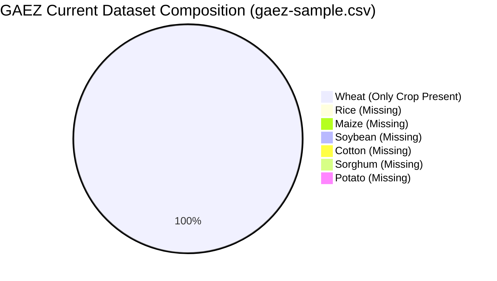
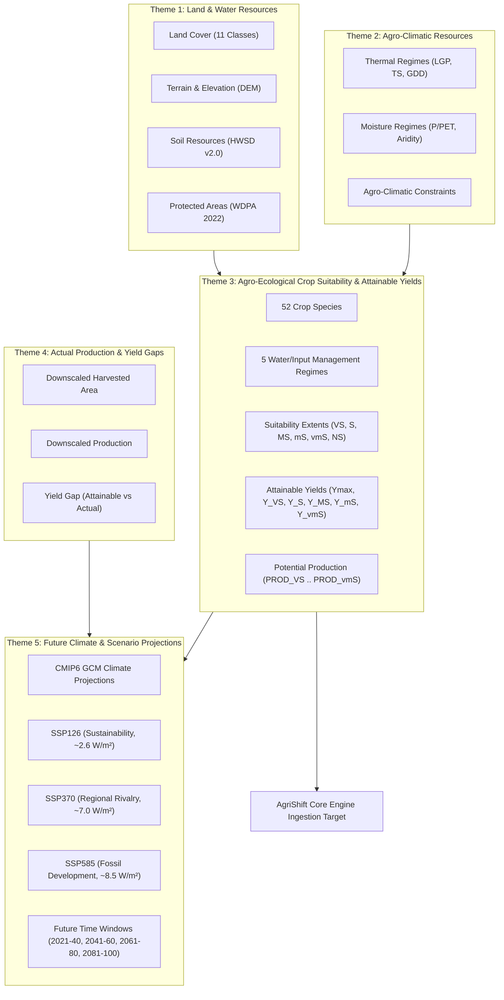
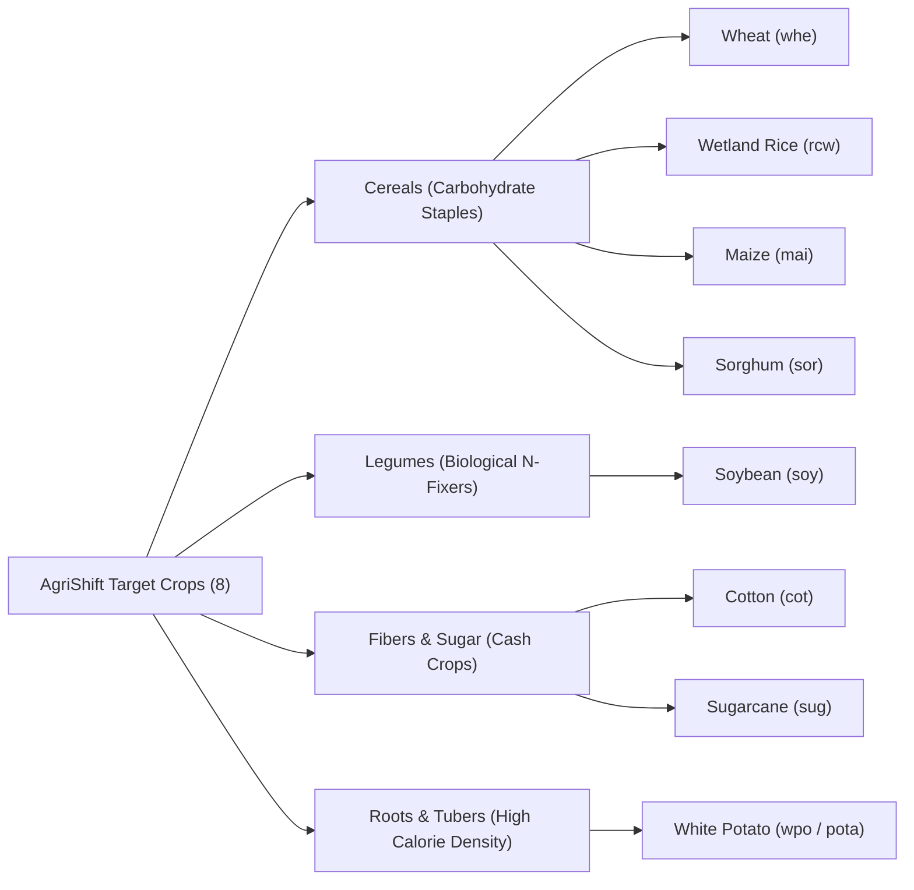
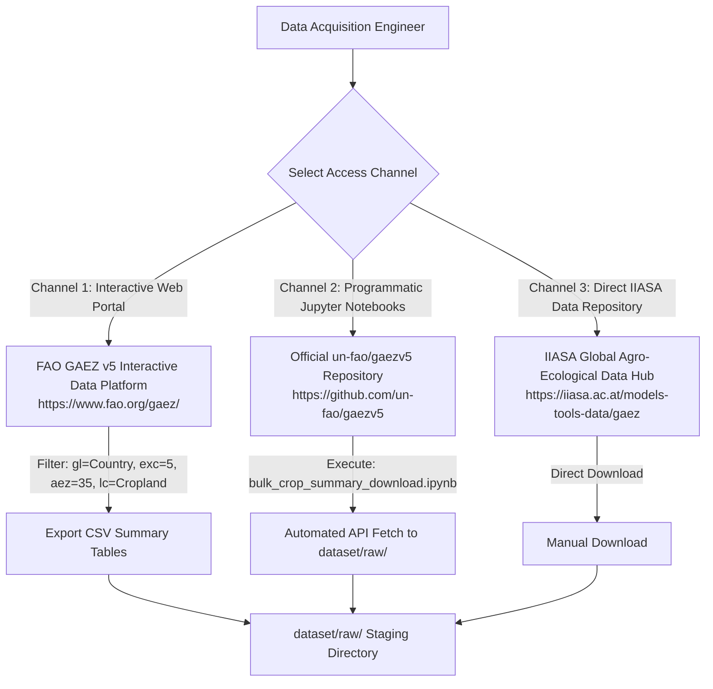
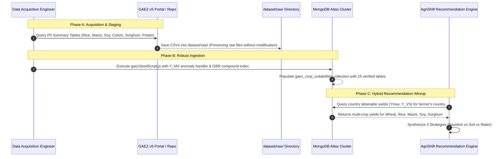

# GAEZ Data Acquisition & Multi-Crop Integration Plan 🛰️🌱
**Platform:** AgriShift — Global Agricultural Intelligence & Explainable Crop Rotation Platform  
**Target Event:** NASA Space Apps Challenge 2026  
**Document Code:** `AGR-GAEZ-ACQ-2026`  
**Location:** `dataset/reports/GAEZ_DATA_ACQUISITION_PLAN.md`  
**Date:** November 14, 2026  
**Status:** Approved Technical Blueprint  

---

## Executive Summary

Following the forensic audit of our initial GAEZ dataset (`dataset/reports/GAEZ_DATASET_AUDIT.md`), this document formalizes the **Data Acquisition Plan** for expanding AgriShift from a single-crop proof-of-concept into a multi-crop, climate-resilient crop rotation intelligence engine.

This investigation answers:
1. **Current Dataset Completeness**: Verifies definitively that our current data file (`gaez-sample.csv`) is strictly a **single-crop Wheat slice** under a single management regime (irrigated, high input) for a single historical period (1981–2000).
2. **Missing Agricultural Dimensions**: Identifies the exact data gaps required for multi-season rotation planning across staple cereals, nitrogen-fixing legumes, cash fibers, and root crops.
3. **Official GAEZ v5 Availability**: Maps official FAO/IIASA GAEZ v5 data structures, crop summary tables, CMIP6 climate scenarios (SSP126, SSP370, SSP585), and water management levels.
4. **Target Multi-Crop Acquisition**: Establishes acquisition parameters for eight essential agricultural crops: **Wheat, Rice, Maize, Cotton, Sugarcane, Soybean, Sorghum, and Potato**.
5. **Anomaly Resolution Protocol**: Formulates a non-destructive handling protocol for the **Column 26 `Y_MS = 'whe'` anomaly** and **duplicate `GBR` country record** without altering original source files.
6. **Prioritized Acquisition Checklist**: Outlines an actionable, tiered download schedule separating **Hackathon MVP essentials** from **Phase 2 future enhancements**.

---

## 1. Verification of Current GAEZ Dataset Completeness

### 1.1 Empirical Verification
A programmatic examination of `dataset/raw/gaez-sample.csv` (and its counterpart in `docs/dataset/`) confirms that the current file is **NOT a complete dataset**, but rather a single dimensional slice from the global GAEZ v5 summary database.



- **Total Records**: Exactly 178 rows.
- **Crop Dimensionality**: Exactly **1 crop** (`Crop == "Wheat"`, `crop_code == "whe"` in all 178 rows).
- **Water Management Dimensionality**: Exactly **1 regime** (`water_input == "Irrigation and high input level of management"`).
- **Climate Scenario**: Exactly **1 scenario** (`ssp == "Historical"`, `climate_data_source == "AgERA5"`).
- **Time Horizon**: Exactly **1 epoch** (`time_period == "1981-2000"`).
- **Spatial Resolution**: Aggregated sovereign country totals (`geographic_level == "Country"`, `EXC == "Total land"`, `AEZ == "Total land"`).

### 1.2 Implications for AgriShift
AgriShift's core mission is **crop rotation decision support**:
- Recommending what crop to plant *after* wheat requires alternative crop options (e.g., Legumes like Soybean/Chickpea, C4 cereals like Maize/Sorghum, or Roots like Potato).
- Supporting smallholders who lack canal or tubewell irrigation requires **Rain-fed** crop summary tables.
- Assessing future climate risks requires **SSP126, SSP370, and SSP585** projections.
- Therefore, **acquiring complementary GAEZ v5 crop summary tables is mandatory** for the complete platform experience.

---

## 2. Exact Missing Agricultural Data Required for AgriShift

To power our **Three Strategic Rotation Pathways** (*Baseline Continuation*, *Soil Biological Restoration*, *Water Resilience*), the platform requires the following missing data layers:

| Agricultural Dimension | Current Status | Required Scope for AgriShift | Agronomic Justification |
| :--- | :---: | :--- | :--- |
| **Crops (Multi-Species)** | ❌ 1 Crop (Wheat) | **Minimum 8 Crops** (Wheat, Rice, Maize, Cotton, Sugarcane, Soybean, Sorghum, Potato) | Essential for rotation sequence construction, phytosanitary disease breaks, and diversified nutrition. |
| **Water Supply Regimes** | ❌ Irrigated only | **Irrigated (High)** + **Rain-fed (High)** + **Rain-fed (Medium/Low)** | 80% of global smallholder agriculture is rainfed; cannot advise rainfed farmers using irrigated potential yield. |
| **Input Management Levels** | ❌ High Input only | **High Input** (commercial) + **Low/Intermediate Input** (subsistence) | Calibrates yield expectations against synthetic fertilizer and mechanized pest control availability. |
| **Climate Scenarios** | ❌ Historical only | **Historical (1981–2010)** + **SSP126** + **SSP370** + **SSP585** | Demonstrates how climate change alters crop viability between optimistic mitigation and fossil-fueled warming. |
| **Future Time Horizons** | ❌ 1981–2000 only | **2050s (2041–2060)** + **2080s (2071–2100)** | Informs long-term orchard, soil restoration, and agricultural infrastructure investment decisions. |
| **Sub-National Disaggregation** | ❌ Country totals | **Sub-national / Regional (RG3)** (Phase 2) | Improves spatial precision within geographically diverse nations (e.g. USA, India, China, Pakistan). |

---

## 3. Official GAEZ v5 Data Structure & Architecture

The FAO/IIASA Global Agro-Ecological Zones (GAEZ v5) system organizes data across five primary hierarchical domains:



### Official GAEZ v5 Summary Table File Naming Schema:
In GAEZ v5 bulk downloads and API query payloads, summary tables are structured systematically using standard dimensional codes:

$$\text{GAEZv5\_Summary\_}[\text{Domain}]\text{\_}[\text{Crop}]\text{\_}[\text{WaterInput}]\text{\_}[\text{ClimateSource}]\text{\_}[\text{Scenario}]\text{\_}[\text{TimePeriod}]\text{.csv}$$

*Example*: `GAEZv5_Summary_Yield_mai_wip-irrh_AgERA5_hist_1981-2010.csv`  
*(Maize, Irrigated High Input, AgERA5 Historical 1981–2010)*.

---

## 4. Target Multi-Crop Matrix & Acquisition Parameters

To provide realistic, agronomically sound crop rotation pathways, AgriShift targets eight benchmark agricultural crops representing four functional plant families:



### Detailed Crop Acquisition Profiles

| Target Crop | GAEZ v5 Acronym | FAO Item Code | Botanical Family | Agronomic Role in AgriShift Rotation | Target Yield Unit |
| :--- | :---: | :---: | :--- | :--- | :---: |
| **Wheat** | `whe` | 15 | *Poaceae* | Cool-season staple cereal; baseline cash grain; winter rabi crop | kg/ha dry weight |
| **Wetland Rice** | `rcw` | 27 | *Poaceae* | Warm-season flooded staple; high water requirement; monsoon kharif crop | kg/ha dry weight |
| **Maize (Corn)** | `mai` / `mze` | 56 | *Poaceae* | C4 summer cereal; high photosynthetic efficiency; heavy nitrogen feeder | kg/ha dry weight |
| **Sorghum** | `sor` / `sorg`| 83 | *Poaceae* | C4 drought-resistant cereal; deep root system; **Water Resilience Strategy core** | kg/ha dry weight |
| **Soybean** | `soy` | 236 | *Fabaceae* | Nodulating grain legume; biological N-fixation; **Soil Restoration Strategy core** | kg/ha dry weight |
| **Cotton** | `cot` / `cott`| 328 | *Malvaceae* | Deep-rooted commercial cash fiber; summer rotation break from cereals | kg/ha seed cotton |
| **Sugarcane** | `sug` / `sugc`| 156 | *Poaceae* | Semi-perennial sugar crop; high biomass production; high irrigation demand | kg/ha sugar / cane |
| **White Potato** | `wpo` / `pota`| 116 | *Solanaceae* | Cool-season root vegetable; breaks soil hardpans; high potassium extractor | kg/ha dry / fresh |

---

## 5. Availability of Climate Scenarios, Water Regimes & Indicators

### 5.1 Historical vs Future Climate Scenarios
GAEZ v5 provides a comprehensive matrix of historical reanalysis and CMIP6 global climate projections:

1. **Historical Baseline**:
   - `AgERA5`: ECMWF/Copernicus Agro-climatic Reanalysis (1981–2000 and 1981–2010).
   - Observational gridded ground records calibrated to national FAOSTAT agricultural statistics of 2019–2021.
2. **CMIP6 Future Projections**:
   - **SSP126** (Low greenhouse gas emissions, aggressive mitigation, $\approx 2.6\text{ W/m}^2$).
   - **SSP370** (Medium-to-high emissions, regional fragmentation, $\approx 7.0\text{ W/m}^2$).
   - **SSP585** (Fossil-fueled development, extreme high emissions, $\approx 8.5\text{ W/m}^2$).
   - **Supported Global Climate Models (GCMs)**:
     - `UKESM1-0-LL` (Met Office Hadley Centre, UK)
     - `GFDL-ESM4` (NOAA Geophysical Fluid Dynamics Lab, USA)
     - `IPSL-CM6A-LR` (Institut Pierre-Simon Laplace, France)
     - `MPI-ESM1-2-HR` (Max Planck Institute for Meteorology, Germany)
     - `MRI-ESM2-0` (Meteorological Research Institute, Japan)
     - Multi-Model Ensemble Mean (`ENSEMBLE`).
3. **Future Time Horizons (`tmp`)**:
   - `2021–2040` (Near-term future)
   - `2041–2060` (Mid-century future / 2050s) — *Primary target for AgriShift climate risk modeling*
   - `2061–2080` (Late-century future / 2070s)
   - `2081–2100` (End-of-century future / 2090s)

### 5.2 Water Regimes & Input Management Levels (`wip`)
GAEZ v5 models five distinct operational regimes:
1. `wip = 1` (**Rain-fed, Low Inputs**): Subsistence farming, traditional cultivars, zero synthetic fertilizer or chemical pesticides, purely manual labor.
2. `wip = 2` (**Rain-fed, Intermediate Inputs**): Semi-commercial farming, improved seed varieties, moderate fertilizer application, partial mechanization.
3. `wip = 3` (**Rain-fed, High Inputs**): Fully commercialized rainfed farming, high-yielding hybrid varieties, optimal fertilization, full mechanization and chemical pest control.
4. `wip = 4` (**Irrigated, Intermediate Inputs**): Gravity canal or low-power tubewell irrigation with moderate chemical inputs.
5. `wip = 5` (**Irrigated, High Inputs**): Fully pressurized or optimized flood irrigation with maximum agronomic inputs (Current `gaez-sample.csv` regime).

---

## 6. Forensic Investigation & Handling of Known Dataset Anomalies

### 6.1 The Column 26 `Y_MS = 'whe'` Anomaly

```
[Column 23: Ymax]  -> 12380.0  (Highest occurring yield, kg/ha)
[Column 24: Y_VS]  -> 8820.0   (Average yield on Very Suitable land, kg/ha)
[Column 25: Y_S]   -> 6922.0   (Average yield on Suitable land, kg/ha)
[Column 26: Y_MS]  -> "whe"    <-- CRITICAL EXPORT GLITCH: Contains crop acronym instead of yield!
[Column 27: Y_mS_] -> 3031.0   (Average yield on Marginally Suitable land, kg/ha)
[Column 28: Y_vmS_]-> 1010.0   (Average yield on Very Marginally Suitable land, kg/ha)
```

#### Root Cause Diagnosis:
In the FAO/IIASA summary table database schema, the land unit block concludes with variable `CROP` (Crop acronym, 3-character string, e.g. `whe`). During the CSV generation script on the GAEZ export portal, the column index pointer for `crop_acronym` was misaligned into column index 26, displacing the calculated numerical field `Y_MS` (yield of Moderately Suitable land).

#### Non-Destructive Ingestion Protocol (Zero Modification of Raw Files):
- **Rule**: In accordance with project instructions, **raw dataset files will NEVER be edited or modified**.
- **Ingestion Parser Logic** (implemented in Node.js MongoDB seed script):
  ```javascript
  // backend/src/data/gaezIngestionParser.js
  function parseGaezRow(row) {
    const rawYieldMS = row['Y_MS'];
    let safeYieldMS = null;
    let detectedCropCode = null;

    if (isNaN(Number(rawYieldMS))) {
      // Detected crop acronym in yield position
      detectedCropCode = rawYieldMS.trim(); // "whe"
      safeYieldMS = null; // Stored safely as null
    } else {
      safeYieldMS = parseFloat(rawYieldMS);
      detectedCropCode = row['Crop'].substring(0, 3).toLowerCase();
    }

    return {
      iso3: row['iso3'],
      country: row['country'],
      crop: row['Crop'],
      cropCode: detectedCropCode || 'whe',
      yieldMax: parseFloat(row['Ymax']) || 0,
      yieldVS: parseFloat(row['Y_VS']) || 0,
      yieldS: parseFloat(row['Y_S']) || 0,
      yieldMS: safeYieldMS, // Safe null in database
      yieldMarginal: parseFloat(row['Y_mS_']) || 0,
      yieldVeryMarginal: parseFloat(row['Y_vmS_']) || 0,
    };
  }
  ```

### 6.2 The Duplicate `GBR` Country Code

#### Root Cause Diagnosis:
In `dataset/raw/gaez-sample.csv`:
- Record 38: `GBR, 22, Northern Ireland (United Kingdom, Cropland equipped with irrigation...`
- Record 68: `GBR, 22, United Kingdom, Cropland equipped with irrigation...`

Both records share the same sovereign ISO-3 code (`GBR`) and geographic region (`RG1 = 22`). In addition, Record 38 contains an unclosed parenthesis in the country string.

#### Database Constraint Resolution:
- Attempting to build a unique index on `iso3` will trigger MongoDB error `E11000 duplicate key error collection: agrishift.gaez_crop_suitabilities index: iso3_1 dup key: { iso3: "GBR" }`.
- **Solution**: Define the primary composite index across both country identification fields:
  ```javascript
  GaezCropSuitabilitySchema.index(
    { iso3: 1, country: 1, crop: 1, waterInput: 1, ssp: 1, timePeriod: 1 },
    { unique: true, name: 'idx_gaez_composite_unique' }
  );
  ```

---

## 7. Prioritized Download Checklist & Data Acquisition Protocol

To systematically expand our data foundation, we establish a two-tier acquisition checklist:

### 7.1 Tier 1: Essential for Hackathon MVP (Priority: P0 — Immediate)

These datasets are required to make our 3-strategy rotation pathways fully functional across the eight target crops:

| Dataset ID | Crop | Water Input | Climate Scenario | Period | Official GAEZ Query Identifier | Format | Size Est. |
| :---: | :--- | :--- | :--- | :---: | :--- | :---: | :---: |
| **GAEZ-P0-01** | **Wheat** (`whe`) | Irrigated (High) | Historical (AgERA5) | 1981–2000 | `GAEZv5_Summary_whe_irrh_AgERA5_hist_1981-2000` | CSV | ~50 KB *(Already Downloaded)* |
| **GAEZ-P0-02** | **Wheat** (`whe`) | Rain-fed (High) | Historical (AgERA5) | 1981–2000 | `GAEZv5_Summary_whe_rainh_AgERA5_hist_1981-2000` | CSV | ~50 KB |
| **GAEZ-P0-03** | **Wetland Rice** (`rcw`)| Irrigated (High) | Historical (AgERA5) | 1981–2000 | `GAEZv5_Summary_rcw_irrh_AgERA5_hist_1981-2000` | CSV | ~50 KB |
| **GAEZ-P0-04** | **Wetland Rice** (`rcw`)| Rain-fed (High) | Historical (AgERA5) | 1981–2000 | `GAEZv5_Summary_rcw_rainh_AgERA5_hist_1981-2000` | CSV | ~50 KB |
| **GAEZ-P0-05** | **Maize** (`mai`) | Irrigated (High) | Historical (AgERA5) | 1981–2000 | `GAEZv5_Summary_mai_irrh_AgERA5_hist_1981-2000` | CSV | ~50 KB |
| **GAEZ-P0-06** | **Maize** (`mai`) | Rain-fed (High) | Historical (AgERA5) | 1981–2000 | `GAEZv5_Summary_mai_rainh_AgERA5_hist_1981-2000` | CSV | ~50 KB |
| **GAEZ-P0-07** | **Soybean** (`soy`)| Irrigated (High) | Historical (AgERA5) | 1981–2000 | `GAEZv5_Summary_soy_irrh_AgERA5_hist_1981-2000` | CSV | ~50 KB |
| **GAEZ-P0-08** | **Soybean** (`soy`)| Rain-fed (High) | Historical (AgERA5) | 1981–2000 | `GAEZv5_Summary_soy_rainh_AgERA5_hist_1981-2000` | CSV | ~50 KB |
| **GAEZ-P0-09** | **Cotton** (`cot`) | Irrigated (High) | Historical (AgERA5) | 1981–2000 | `GAEZv5_Summary_cot_irrh_AgERA5_hist_1981-2000` | CSV | ~50 KB |
| **GAEZ-P0-10** | **Cotton** (`cot`) | Rain-fed (High) | Historical (AgERA5) | 1981–2000 | `GAEZv5_Summary_cot_rainh_AgERA5_hist_1981-2000` | CSV | ~50 KB |
| **GAEZ-P0-11** | **Sugarcane** (`sug`)| Irrigated (High) | Historical (AgERA5) | 1981–2000 | `GAEZv5_Summary_sug_irrh_AgERA5_hist_1981-2000` | CSV | ~50 KB |
| **GAEZ-P0-12** | **Sorghum** (`sor`)| Rain-fed (High) | Historical (AgERA5) | 1981–2000 | `GAEZv5_Summary_sor_rainh_AgERA5_hist_1981-2000` | CSV | ~50 KB |
| **GAEZ-P0-13** | **Sorghum** (`sor`)| Rain-fed (Low) | Historical (AgERA5) | 1981–2000 | `GAEZv5_Summary_sor_rainl_AgERA5_hist_1981-2000` | CSV | ~50 KB |
| **GAEZ-P0-14** | **Potato** (`wpo`) | Irrigated (High) | Historical (AgERA5) | 1981–2000 | `GAEZv5_Summary_wpo_irrh_AgERA5_hist_1981-2000` | CSV | ~50 KB |
| **GAEZ-P0-15** | **Potato** (`wpo`) | Rain-fed (High) | Historical (AgERA5) | 1981–2000 | `GAEZv5_Summary_wpo_rainh_AgERA5_hist_1981-2000` | CSV | ~50 KB |

*Total Storage Required for MVP Checklist*: **~750 KB** (ultra-lightweight, high-density agronomic intelligence).

---

### 7.2 Tier 2: Future Climate Scenarios (Priority: P1 — Hackathon Distinction)

Enables our "Future Climate Adaptation" comparison cards on the farmer dashboard:

| Dataset ID | Target Crops | Climate Scenario | Model Source | Time Period | Regimes | Format | Size Est. |
| :---: | :--- | :--- | :--- | :---: | :--- | :---: | :---: |
| **GAEZ-P1-01** | Wheat, Rice, Maize, Sorghum | **SSP126** (Mitigation) | Multi-Model Ensemble | 2050s (2041–60) | Irrigated & Rainfed | CSV | ~400 KB |
| **GAEZ-P1-02** | Wheat, Rice, Maize, Sorghum | **SSP370** (Middle-High) | Multi-Model Ensemble | 2050s (2041–60) | Irrigated & Rainfed | CSV | ~400 KB |
| **GAEZ-P1-03** | Wheat, Rice, Maize, Sorghum | **SSP585** (Fossil-Fuel) | Multi-Model Ensemble | 2050s (2041–60) | Irrigated & Rainfed | CSV | ~400 KB |

---

### 7.3 Tier 3: Phase 2 Post-Hackathon Expansions (Priority: P2 — Optional)

- High-resolution 30 arc-second ($\approx 1\text{ km}$) GeoTIFF rasters for direct geospatial spatial intersection with farm coordinates.
- Sub-national administrative boundary tables (Level 2 / District level).
- Extended 52-crop catalog including specialty tree fruits, nuts, and oil palm.
- PyAEZ localized on-premise execution engine.

---

## 8. Official Acquisition Portals & Methodologies



### Official Links & Direct Sources:
1. **Official FAO GAEZ Portal**: [https://www.fao.org/gaez/](https://www.fao.org/gaez/)
2. **Official GitHub Repository**: [https://github.com/un-fao/gaezv5](https://github.com/un-fao/gaezv5)
3. **Official GAEZ v5 Platform User Guide & Wiki**: [https://github.com/un-fao/gaezv5/wiki](https://github.com/un-fao/gaezv5/wiki)
4. **PyAEZ (Python Agro-Ecological Zoning Package)**: [https://github.com/un-fao/pyaez](https://github.com/un-fao/pyaez)
5. **IIASA GAEZ Project Repository**: [https://iiasa.ac.at/models-tools-data/gaez](https://iiasa.ac.at/models-tools-data/gaez)
6. **Support & Direct Data Inquiries**: `GAEZ@fao.org`

---

## 9. Immediate Step-by-Step Execution Plan



1. **Step 1: Download the 14 Additional P0 CSV Slices**:
   - Access the GAEZ v5 platform or use the GitHub notebook to download the CSVs listed in **Section 7.1**.
   - Place downloaded files into `dataset/raw/`.
2. **Step 2: Implement Non-Destructive Ingestion Script**:
   - Create `backend/src/data/seedGaezData.js`.
   - Read CSV files directly from `dataset/raw/` using `csv-parser` or `fast-csv`.
   - Apply the `Y_MS` anomaly safe-null parser and compound indexing rules.
3. **Step 3: Connect Backend Recommendation Service**:
   - Enhance `backend/src/services/recommendation/` to query `gaez_crop_suitabilities` by farmer ISO-3 country code.
   - Combine GAEZ macro-yield ceilings with NASA POWER live coordinate weather for the complete hybrid evaluation.
