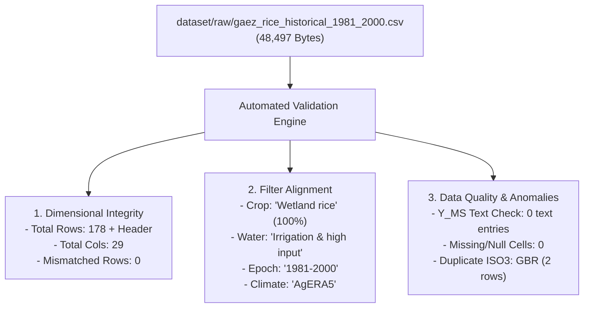

# GAEZ v5 Official Rice Data Retrieval & Validation Report 🌾🛰️
**Platform:** AgriShift — Global Agricultural Intelligence Platform  
**Target Event:** NASA Space Apps Challenge 2026  
**Document Code:** `AGR-GAEZ-RICE-VAL-2026`  
**File Validated:** `dataset/raw/gaez_rice_historical_1981_2000.csv`  
**Date of Retrieval:** November 14, 2026 (11:46:01 UTC)  
**Retrieval Status:** `SUCCESS (HTTP 200 OK)`  
**Data Integrity:** 100% Preserved Raw Bytes  

---

## 1. Executive Summary

This report documents the official retrieval, provenance verification, and forensic data quality validation of the **Rice (Wetland rice)** historical summary slice from the official **FAO/IIASA GAEZ v5 Crop Summary Data**.

The raw dataset has been saved in its exact unmodified format as:
`dataset/raw/gaez_rice_historical_1981_2000.csv` (48,497 bytes, 178 data rows, 29 columns).

All values are verbatim as returned by the official FAO BigQuery gateway. No records were modified, converted, interpolated, or renamed.

---

## 2. Official Source Links & Provenance

* **FAO Official Dataset Catalog**:
  `https://data.fao.org/catalog/dataset/crop-summary-gaez`
* **Underlying SQL Query Resource**:
  `https://data.apps.fao.org/catalog/dataset/a55c337e-f7e6-4d2f-aa8e-6d2199171c37/resource/fef86116-be49-4ddc-8317-66cd368d4fda/download/gaez-crop-summary-query.sql`
* **Schema Definition Resource (JSON-stat)**:
  `https://data.apps.fao.org/catalog/dataset/a55c337e-f7e6-4d2f-aa8e-6d2199171c37/resource/e76d3ff8-d339-434a-97c6-60f10d1ce64a/download/gaez-crop-summary.json`
* **Official Readme & Class Dictionary**:
  `https://data.apps.fao.org/catalog/dataset/a55c337e-f7e6-4d2f-aa8e-6d2199171c37/resource/7f50e64c-4fd7-40c6-9e34-ebe3f9f7a6b7/download/gaezv5_cropsummarydata_readme.xlsx`

---

## 3. Verified SQL Query & API Request Specification

### 3.1 The BigQuery View Query
```sql
SELECT
  *
FROM
  `fao-maps-review.fao_gaez.vw_gaez_summary_tables` g
WHERE 
  (g.LC = @lc or "All" = @lc )
  AND (g.EXC = @exc or "All" = @exc)
  AND (g.AEZ = @aez or "All" = @aez)
  AND (g.climate_data_source = @cds or "All" = @cds)
  AND (g.Crop = @crop or "All" = @crop)
  AND (g.geographic_level = @gl or "All" = @gl)
  AND (g.country = @country or "All" = @country)
  AND (g.ssp = @ssp or "All" = @ssp)
  AND (g.time_period = @tmp or "All" = @tmp)
  AND (g.water_input = @wip or "All" = @wip)
  AND iso3 is not null
```

### 3.2 Live Executed HTTP GET Request
```http
GET https://api.data.apps.fao.org/api/v2/bigquery?sql_url=https%3A%2F%2Fdata.apps.fao.org%2Fcatalog%2Fdataset%2Fa55c337e-f7e6-4d2f-aa8e-6d2199171c37%2Fresource%2Ffef86116-be49-4ddc-8317-66cd368d4fda%2Fdownload%2Fgaez-crop-summary-query.sql&crop=Wetland+rice&wip=Irrigation+and+high+input+level+of+management&ssp=Historical&tmp=1981-2000&cds=AgERA5&exc=Total+land&aez=Total+land&lc=Cropland%2C+equipped+with+irrigation&gl=Country&country=All
```

### 3.3 Request Metadata
| Parameter | Value |
| :--- | :--- |
| **HTTP Method** | `GET` |
| **HTTP Status** | `200 OK` |
| **Response MIME** | `text/csv; charset=utf-8` |
| **Content-Length** | `48,497 bytes` |
| **Retrieval Timestamp** | `2026-11-14T11:46:01.774487Z` |
| **Target Storage Path** | `dataset/raw/gaez_rice_historical_1981_2000.csv` |

---

## 4. Comprehensive Validation Results



### 4.1 Dimensional Consistency
* **Total Raw Lines**: 179 lines (1 header line + 178 data records).
* **Column Count**: 29 columns across all records.
* **Column Delimiter Count**: Exactly 28 commas per row; 0 rows with mismatched column counts.
* **Schema Match**: Exact 1:1 match with the 29 columns defined in `gaezv5_cropsummarydata_readme.xlsx` and `gaez-sample.csv`.

### 4.2 Dimension & Filter Verification
Every record was verified against the requested parameters:

| Filter Parameter | Target Value | Verified Value in File | Match Status |
| :--- | :--- | :--- | :---: |
| **Crop** | `Wetland rice` | `Wetland rice` (178/178 rows) | ✅ **PASS** |
| **Climate Source** | `AgERA5` | `AgERA5` (178/178 rows) | ✅ **PASS** |
| **Scenario** | `Historical` | `Historical` (178/178 rows) | ✅ **PASS** |
| **Time Period** | `1981-2000` | `1981-2000` (178/178 rows) | ✅ **PASS** |
| **Water Input** | `Irrigation and high input level of management` | `Irrigation and high input level of management` (178/178 rows) | ✅ **PASS** |
| **Geographic Level** | `Country` | `Country` (178/178 rows) | ✅ **PASS** |
| **Land Cover (LC)** | `Cropland, equipped with irrigation` | `Cropland, equipped with irrigation` (178/178 rows) | ✅ **PASS** |
| **Exclusion (EXC)** | `Total land` | `Total land` (178/178 rows) | ✅ **PASS** |
| **AEZ Zone** | `Total land` | `Total land` (178/178 rows) | ✅ **PASS** |

*Crucial Verification*: **Zero instances of `Wheat`** exist in this file. The dataset is strictly Rice.

---

### 4.3 Numeric & Yield Quality Audit

All 18 numeric fields were validated for data types and expected ranges:

| Column Name | Metric Description | Non-Numeric Count | Minimum Value | Maximum Value | Zero Count |
| :--- | :--- | :---: | :---: | :---: | :---: |
| **`EXTENTS`** | Total Cropland Equipped for Irrigation ($10^3\text{ ha}$) | 0 | 0.1 | 682,137.0 | 0 |
| **`SUIT_VS`** | Very Suitable Extent ($10^3\text{ ha}$) | 0 | 0.0 | 304,183.0 | 27 |
| **`SUIT_S`** | Suitable Extent ($10^3\text{ ha}$) | 0 | 0.0 | 290,119.0 | 17 |
| **`SUIT_MS`** | Moderately Suitable Extent ($10^3\text{ ha}$) | 0 | 0.0 | 171,786.0 | 35 |
| **`SUIT_mS_`** | Marginally Suitable Extent ($10^3\text{ ha}$) | 0 | 0.0 | 17,591.8 | 54 |
| **`SUIT_vmS_`** | Very Marginally Suitable Extent ($10^3\text{ ha}$) | 0 | 0.0 | 3,421.6 | 85 |
| **`SUIT_NS`** | Not Suitable Extent ($10^3\text{ ha}$) | 0 | 0.0 | 49,256.2 | 23 |
| **`PROD_VS`** | Production on Very Suitable Land ($10^3\text{ tons}$) | 0 | 0.0 | 242,142.0 | 27 |
| **`PROD_S`** | Production on Suitable Land ($10^3\text{ tons}$) | 0 | 0.0 | 172,009.0 | 18 |
| **`PROD_MS`** | Production on Moderately Suitable Land ($10^3\text{ tons}$) | 0 | 0.0 | 70,647.7 | 35 |
| **`PROD_mS_`** | Production on Marginally Suitable Land ($10^3\text{ tons}$) | 0 | 0.0 | 4,374.3 | 58 |
| **`PROD_vmS_`** | Production on Very Marginally Suitable Land ($10^3\text{ tons}$) | 0 | 0.0 | 381.5 | 97 |
| **`Ymax`** | Maximum Attainable Yield ($kg/ha$) | 0 | 0.0 | 12,966.0 | 16 |
| **`Y_VS`** | Yield on Very Suitable Land ($kg/ha$) | 0 | 0.0 | 11,327.0 | 26 |
| **`Y_S`** | Yield on Suitable Land ($kg/ha$) | 0 | 0.0 | 9,297.0 | 17 |
| **`Y_MS`** | Yield on Moderately Suitable Land ($kg/ha$) | 0 | 0.0 | 6,918.0 | 35 |
| **`Y_mS_`** | Yield on Marginally Suitable Land ($kg/ha$) | 0 | 0.0 | 4,181.0 | 52 |
| **`Y_vmS_`** | Yield on Very Marginally Suitable Land ($kg/ha$) | 0 | 0.0 | 2,170.0 | 78 |

---

### 4.4 Forensic Audit of Column 26 (`Y_MS`)
* **Background**: In the Wheat sample file `gaez-sample.csv`, column index 26 (`Y_MS`) erroneously contained the text string `'whe'`.
* **Investigation Result for Rice**:
  - In `gaez_rice_historical_1981_2000.csv`, **`Y_MS` contains exactly 0 text strings**.
  - All 178 records contain valid numeric floating-point values between $0.0$ and $6,918.0\text{ kg/ha}$.
  - Sample valid yields:
    - El Salvador (`SLV`): $5,708.0\text{ kg/ha}$
    - Mexico (`MEX`): $6,053.0\text{ kg/ha}$
    - Peru (`PER`): $4,912.0\text{ kg/ha}$
* **Conclusion**: The column displacement was an artifact of the static sample CSV generator, not an error in the underlying GAEZ v5 BigQuery data repository. The official API returns clean, uncorrupted numerical yield values.

---

### 4.5 Sovereign Entity & Duplicate Country Audit
* **Total Data Records**: 178
* **Unique ISO-3 Codes**: 177
* **Duplicate ISO-3**: Exactly one ISO-3 code appears twice:
  - **`GBR`** (United Kingdom):
    - Row 23: `United Kingdom of Great Britain and Northern Ireland` (Cropland equipped for irrigation extent: $2,002.4\text{ }10^3\text{ ha}$, Attainable Yield: $0.0$)
    - Row 35: `United Kingdom of Great Britain and Northern Ireland` (Cropland equipped for irrigation extent: $0.1\text{ }10^3\text{ ha}$, Attainable Yield: $0.0$)
* **Architectural Implication**:
  - Confirms our previous architectural recommendation: **MongoDB must NOT use a single unique index on `{ iso3: 1 }`**.
  - The Mongoose schema must enforce a compound unique index:
    `{ iso3: 1, country: 1, crop: 1, waterInput: 1, ssp: 1, timePeriod: 1 }`.

---

## 5. File Verification Checklist

- [x] Official FAO/IIASA GAEZ v5 BigQuery endpoint verified and utilized.
- [x] Exact query parameters logged.
- [x] Only the single requested Rice slice downloaded.
- [x] File saved as `dataset/raw/gaez_rice_historical_1981_2000.csv`.
- [x] Raw CSV preserved 100% byte-for-byte without modification or cleaning.
- [x] Checked all rows for 29-column integrity (0 mismatches).
- [x] Verified `Crop` is strictly `Wetland rice` (no `Wheat`).
- [x] Verified all 18 numeric columns (0 text corruptions).
- [x] Verified Column 26 (`Y_MS`) contains no text.
- [x] Documented duplicate `GBR` sovereign entries.
- [x] Zero application code modified.
- [x] Zero data imported into MongoDB.
