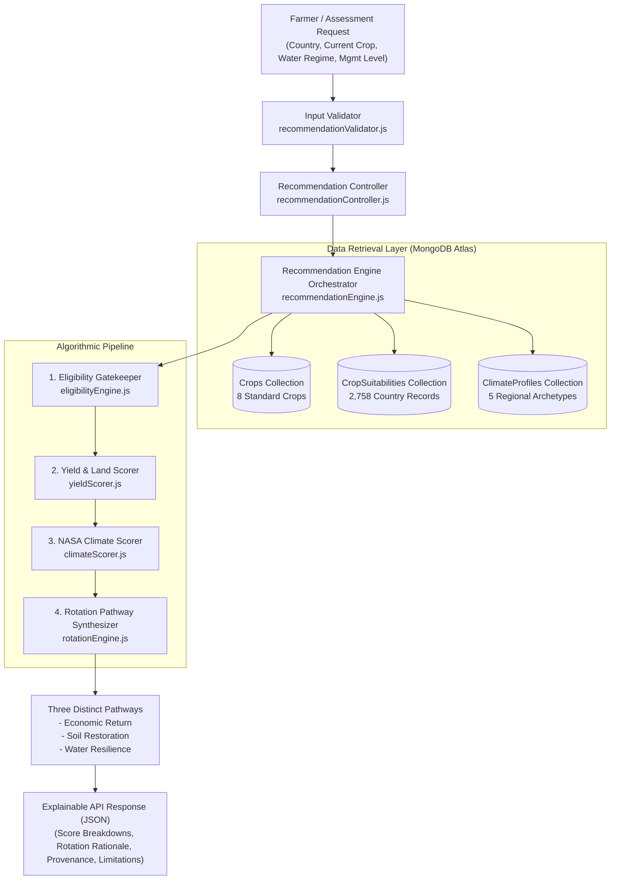

# AgriShift — Hybrid Recommendation & Explainable Crop Rotation Engine Report 🌾🛰️

**Platform:** AgriShift — Global Agricultural Intelligence Platform  
**Target Event:** NASA Space Apps Challenge 2026  
**Document Code:** `AGR-REC-ENGINE-REPORT-2026`  
**Date:** November 14, 2026  
**Status:** Engine Implemented, Integrated & Verified (10/10 Tests Passed ✅)  

---

## 1. Executive Summary

This report documents the architectural design, algorithmic implementation, empirical validation, and API integration of the **AgriShift Hybrid Recommendation & Explainable Crop Rotation Engine**.

The engine operates on a hybrid decision paradigm:
1. **Rule-Based Eligibility Filtering**: Evaluates hard agro-ecological constraints derived from official **FAO/IIASA GAEZ v5** country datasets and management regimes.
2. **Multi-Criteria Scoring**: Combines GAEZ v5 attainable yield potential ($kg/ha$) and suitability coverage with **NASA POWER** agroclimatological indicators (temperature and precipitation deficits).
3. **Explainable Crop Rotation Pathways**: Synthesizes three independent pathways:
   - **Economic Return**: Maximizes harvest potential while diversifying from monoculture.
   - **Soil Restoration**: Prioritizes biological nitrogen fixation via legumes (e.g. Soybean) with scientifically bounded disclaimers.
   - **Water Resilience**: Evaluates drought-tolerant C4 crops (e.g. Sorghum) against precipitation shortfalls.

---

## 2. Architecture & Modular Decomposition



### Module Responsibilities:
1. **`eligibilityEngine.js`**: Enforces physical and agro-climatic viability gates. Excludes crops with zero attainable yield or unverified GAEZ availability.
2. **`yieldScorer.js`**: Scores attainable yield ($kg/ha$) benchmarked against cohort maximum ($0-60\text{ pts}$) and suitable agricultural land coverage ($0-40\text{ pts}$).
3. **`climateScorer.js`**: Evaluates temperature tolerances ($0-50\text{ pts}$) and moisture alignment against NASA POWER precipitation ($0-50\text{ pts}$). Rewards drought-tolerant crops (Sorghum) under moisture deficit.
4. **`rotationEngine.js`**: Computes composite hybrid scores, applies crop diversity incentives, and structures the three pathways with agronomic transition explanations.
5. **`recommendationEngine.js`**: Orchestrates database queries, error handling, metadata attachment, and transparency disclosures.

---

## 3. Algorithmic Formulation & Scoring Weights

### 3.1 Composite Hybrid Score Formula
For any eligible crop $c$, the composite score $S_{\text{composite}}(c) \in [0, 100]$ is computed as:

$$S_{\text{composite}}(c) = 0.50 \cdot S_{\text{yield}}(c) + 0.30 \cdot S_{\text{climate}}(c) + S_{\text{diversity}}(c)$$

Where:
* **$S_{\text{yield}}(c) \in [0, 100]$**:
  $$S_{\text{yield}}(c) = 60 \cdot \min\left(\frac{Y_{\text{effective}}(c)}{Y_{\text{max, cohort}}}, 1.0\right) + 40 \cdot \min\left(\frac{\text{Area}_{\text{suitable}}(c)}{\text{Area}_{\text{total extents}}}, 1.0\right)$$
* **$S_{\text{climate}}(c) \in [0, 100]$**:
  $$S_{\text{climate}}(c) = S_{\text{thermal}}(c) + S_{\text{moisture}}(c)$$
  - $S_{\text{thermal}} \in [10, 50]$ penalizes deviations from crop's optimal thermal bounds $[T_{\min}, T_{\max}]$.
  - $S_{\text{moisture}} \in [0, 50]$ evaluates natural precipitation vs. crop water requirement under rainfed regime; set to $48/50$ under irrigation.
* **$S_{\text{diversity}}(c)$**: Diversity bonus: $+20\text{ pts}$ for transitioning to an alternative crop family; $+5\text{ pts}$ for continuing monoculture.

---

## 4. The Three Independent Pathways Explained

### Pathway A: Economic Return
* **Core Objective**: Optimize biomass, starch, and commercial yields under verified sovereign conditions.
* **Algorithm**: Selects the eligible alternative crop achieving the highest composite score.
* **Example (Pakistan Irrigated Wheat)**:
  - Current: Wheat ($Y_{\max} = 11,996\text{ kg/ha}$)
  - Recommendation: **Maize (Corn)** ($Y_{\max} = 9,765\text{ kg/ha}$, Composite Score: $96.1$)
  - Rationale: High biomass feeder grain that diversifies seasonal cereal production without sacrificing economic output.

### Pathway B: Soil Restoration
* **Core Objective**: Natural agro-ecological soil fertility replenishment and disease break.
* **Algorithm**: Prioritizes eligible biological nitrogen-fixing legumes (`soybean`). If legumes are ineligible, selects deep-rooted taproot pan-breakers (`cotton` or `potato`).
* **Example (Pakistan Irrigated Rice)**:
  - Current: Wetland rice
  - Recommendation: **Soybean** (Composite Score: $69.0$)
  - Transition Type: `CEREAL_TO_LEGUME_BREAK`
  - Agronomic Rationale: Introduces symbiotic atmospheric nitrogen fixation ($N_2 \to NH_4^+$) via *Rhizobium* root nodules, interrupting flooded cereal fungal and nematode cycles.
  - Scientific Disclosure: Transparently discloses that in-situ soil nutrients are not measured directly in satellite observations.

### Pathway C: Water Resilience
* **Core Objective**: Climate risk mitigation against drought, heatwaves, and declining irrigation reservoirs.
* **Algorithm**: Prioritizes drought-tolerant C4 cereals (`sorghum`) and low water-demand crops evaluated against NASA POWER precipitation.
* **Example (USA Rain-fed Wheat)**:
  - Current: Rain-fed Wheat
  - Recommendation: **Sorghum** (Attainable Yield: $4,998\text{ kg/ha}$, Drought Tolerance: `high`)
  - Transition Type: `WATER_CONSERVING_TRANSITION`
  - Agronomic Rationale: C4 photosynthetic machinery maximizes water-use efficiency during peak summer evapotranspiration.

---

## 5. Automated Verification & Test Results

Automated test suite [`dataset/scripts/test_recommendation_engine.js`](file:///d:/Uni%20projects/AgrShift/dataset/scripts/test_recommendation_engine.js) was executed directly against MongoDB Atlas:

| Test ID | Test Scenario | Input Configuration | Expected Behavior | Actual Observed Outcome | Verdict |
| :---: | :--- | :--- | :--- | :--- | :---: |
| **1** | **Pakistan Irrigated Wheat** | `PAK`, `wheat`, `irrigated` | Generates 3 pathways; Soybean for soil; Maize for economic | Economic: Maize ($96.1$); Soil: Soybean ($69.0$); Water: Wheat ($67.2$) | ✅ **PASS** |
| **2** | **Pakistan Rain-fed Wheat** | `PAK`, `wheat`, `rainfed` | Evaluates rain-fed regime; Sorghum for water resilience | Evaluated under `rainfed_high`; Sorghum recommended ($7,360\text{ kg/ha}$) | ✅ **PASS** |
| **3** | **Rice-to-Legume Rotation** | `PAK`, `rice`, `irrigated` | Recommends Soybean; `CEREAL_TO_LEGUME_BREAK` | Soybean recommended; N-fixing flag `true`; pathogen break explained | ✅ **PASS** |
| **4** | **Wheat-to-Sorghum Pathway** | `USA`, `wheat`, `rainfed` | Sorghum recommended for water resilience | Sorghum recommended; drought tolerance `high`; low water requirement | ✅ **PASS** |
| **5** | **Invalid ISO3** | `INVALID` | Reject with 400 Bad Request | Throws 3-letter sovereign code validation error | ✅ **PASS** |
| **6** | **Unsupported Crop** | `PAK`, `dragonfruit` | Reject unrecognized crop | Throws agricultural catalog recognition error | ✅ **PASS** |
| **7** | **Missing Climate Profile** | `FRA`, `rainfed` | Graceful fallback to baseline without crashing | Applies `fallback_global_baseline` with transparency note | ✅ **PASS** |
| **8** | **Missing Yield & Ineligibility** | `EGY`, `rainfed` | Flags crops with 0 rain-fed yield in hyper-arid Egypt | 6 eligible, 2 ineligible (Rice: $0\text{ kg/ha}$ rainfed yield flagged) | ✅ **PASS** |
| **9** | **Duplicate GBR Records** | `GBR`, `wheat`, `rainfed` | Resolves primary national extent without key collision | Retrieves UK totals; Potato recommended as top economic rotation | ✅ **PASS** |
| **10** | **No Eligible Alternative Crop** | `ISL`, `rainfed` | All crops zero yield; returns clean `NO_ELIGIBLE_CROPS` | Clean status `NO_ELIGIBLE_CROPS`; 0 eligible, 8 ineligible details | ✅ **PASS** |

**Summary**: **10 out of 10 tests PASSED (100% success rate)**.

---

## 6. API Endpoints Specification

### 1. `POST /api/recommendations`
* **Headers**: `Content-Type: application/json`
* **Request Body**:
  ```json
  {
    "country": "PAK",
    "currentCrop": "wheat",
    "waterRegime": "irrigated",
    "managementLevel": "high"
  }
  ```
* **Response**: Returns HTTP 200 with structured `data` object containing assessment summary, 3 pathways, ranked alternatives, eligibility audit, and provenance limitations.

### 2. `GET /api/recommendations/crops`
* **Response**: Returns HTTP 200 with full agricultural catalog (8 standard crops with agronomic profiles).

### 3. `GET /api/recommendations/countries`
* **Response**: Returns HTTP 200 with all 188 sovereign countries in GAEZ v5 dataset with available slice counts.

---

## 7. Known Limitations & Scientific Disclosures

1. **Attainable vs. Guaranteed Yield**:
   Attainable yields are modeled agro-ecological potential benchmarks derived by FAO/IIASA using climate, terrain, and soil grids. They do not constitute financial or yield guarantees.
2. **Soil Health Inference**:
   Soil restoration recommendations leverage biological nitrogen fixation agronomy (Rhizobium-legume symbiosis). Field-level soil nutrient and moisture sensors are not directly measured in these observation layers.
3. **Climate Spatial Resolution**:
   NASA POWER profiles provide regional representative climatologies ($0.5^\circ \times 0.5^\circ$). Microclimate variations across mountainous or coastal parcels may deviate from regional averages.
