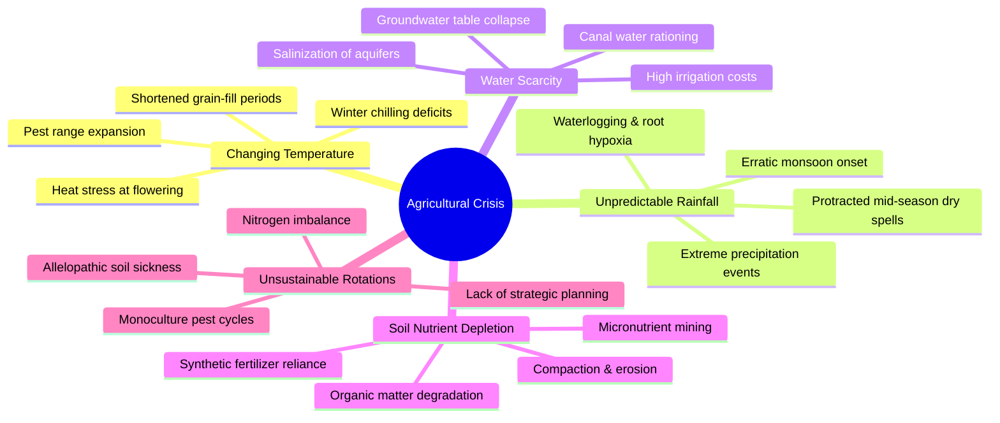

# 01 — Problem Statement: The Agronomic & Climate Crisis 🌍

---

## 1. Context & Global Landscape

Agriculture is the foundation of human civilization, sustaining over 8 billion people and providing livelihoods for more than 1 billion agricultural workers. However, contemporary farming systems are experiencing severe systemic stress caused by the intersection of anthropogenic climate disruption, water depletion, and industrial soil degradation.

Historically, agricultural decisions were governed by generational folklore and established seasonal calendars. Today, shifting climatic regimes have rendered traditional wisdom obsolete. Farmers who continue traditional monocultures or poorly planned crop sequences face mounting yield losses, catastrophic economic failures, and accelerated environmental collapse.

---

## 2. Key Agricultural Challenges

### 2.1 Changing Temperature & Thermal Anomalies
- **Heat Spikes during Reproductive Phases**: Elevated temperatures during critical anthesis (flowering) cause pollen sterility in staple cereals like wheat and maize, drastically cutting harvest yields.
- **Truncated Growing Cycles**: Higher average nighttime temperatures accelerate crop phenological development, leading to prematurely shortened grain-filling periods and lower grain weight.
- **Pest & Pathogen Migration**: Warmer winters fail to suppress overwintering insect larvae and fungal spores, expanding the geographic range and frequency of crop epidemics.

### 2.2 Unpredictable Precipitation Dynamics
- **Delayed & Compressed Rainfall**: Farmers frequently prepare land for historical planting dates only to experience prolonged dry spells, followed by intense rain downpours that wash away seedlings and cause severe sheet erosion.
- **Mid-Season Drought Stress**: Rainfed farming systems are especially susceptible to multi-week dry intervals during vegetative spurts, triggering terminal moisture stress.
- **Excess Moisture & Soil Hypoxia**: Sudden extreme precipitation events saturate poorly drained soils, cutting off oxygen to root systems and fostering fungal root rot (*Pythium*, *Phytophthora*).

### 2.3 Severe Water Scarcity & Depletion
- **Aquifer Exhaustion**: Excessive tubewell pumping for thirsty crops (such as paddy rice or sugarcane in semi-arid zones) has lowered water tables by several meters annually.
- **Energy & Economic Burdens**: Deep tubewell extraction requires high electricity or diesel expenditure, trapping smallholders in debt cycles.
- **Secondary Soil Salinization**: Over-irrigation with mineralized groundwater leaves toxic salt deposits on surface soil, destroying arable farm acreage.

### 2.4 Soil Nutrient Depletion & Biological Exhaustion
- **Soil Organic Matter (SOM) Loss**: Continuous cultivation without organic matter restitution has reduced SOM levels below 1% in millions of hectares of agricultural land worldwide.
- **Chemical Fertilizer Over-Reliance**: Synthetic fertilizers ($N\text{-}P\text{-}K$) mask soil health degradation in the short term while acidifying soils, killing beneficial soil mycorrhizae, and polluting downstream water bodies through nitrate leaching.
- **Micronutrient Mining**: Heavy-feeding crops continually deplete zinc, iron, and boron from root zones without biological replenishment.

### 2.5 Unsustainable Crop Rotation & Monoculture Practices
- **Consecutive Monocropping**: Planting crops of the same botanical family back-to-back concentrates host-specific pests (e.g. root-knot nematodes, *Fusarium* wilt, stem borers).
- **Allelopathic Autotoxicity**: Roots of certain crops exude chemical compounds that accumulate in the soil, inhibiting germination of identical or related successor crops.
- **Opaque Extension Advice**: Farmers are frequently targeted by commercial product vendors promoting chemical fixes, rather than received unbiased, ecological crop rotation advice.

---

## 3. How AgriShift Systematically Resolves These Challenges

| Agronomic Challenge | Conventional Farm Reaction | The AgriShift Solution |
| :--- | :--- | :--- |
| **Thermal Volatility** | Plants based on outdated calendar; risks heat abortion | Ingests NASA POWER 30-year thermal profiles (`T2M`, `T2M_MAX`, `T2M_MIN`) to filter out heat-vulnerable crops and align growing periods with safe temperature windows. |
| **Erratic Rainfall** | Assumes normal rains; suffers seedling wash-out or drought | Analyzes NASA corrected precipitation data (`PRECTOTCORR`) to model local moisture deficits and formulate drought-resilient crop sequences. |
| **Water Scarcity** | Continues thirsty crops until tubewell runs dry | Evaluates crop Water-Use Efficiency (WUE) and generates a dedicated **Water Resilience Strategy** featuring low-water C4 cereals and drought-tolerant pulses. |
| **Soil Degradation** | Applies heavier synthetic fertilizer doses | Synthesizes a dedicated **Soil Restoration Strategy** prioritizing biological nitrogen-fixing legumes, deep taproots, and high organic biomass contributors. |
| **Pest & Disease Carryover** | Sprays broad-spectrum chemical pesticides | Enforces hard botanical family rotation gates (Stage 1 Filtering) to systematically break pathogen life cycles. |
| **Lack of Transparency** | Blindly trusts vendor or black-box app advice | Provides itemized score breakdowns, explicit limitation statements, and NASA satellite citations so farmers understand the *Why* behind every decision. |
