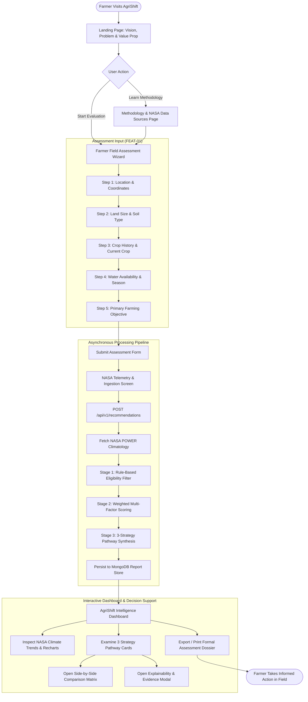
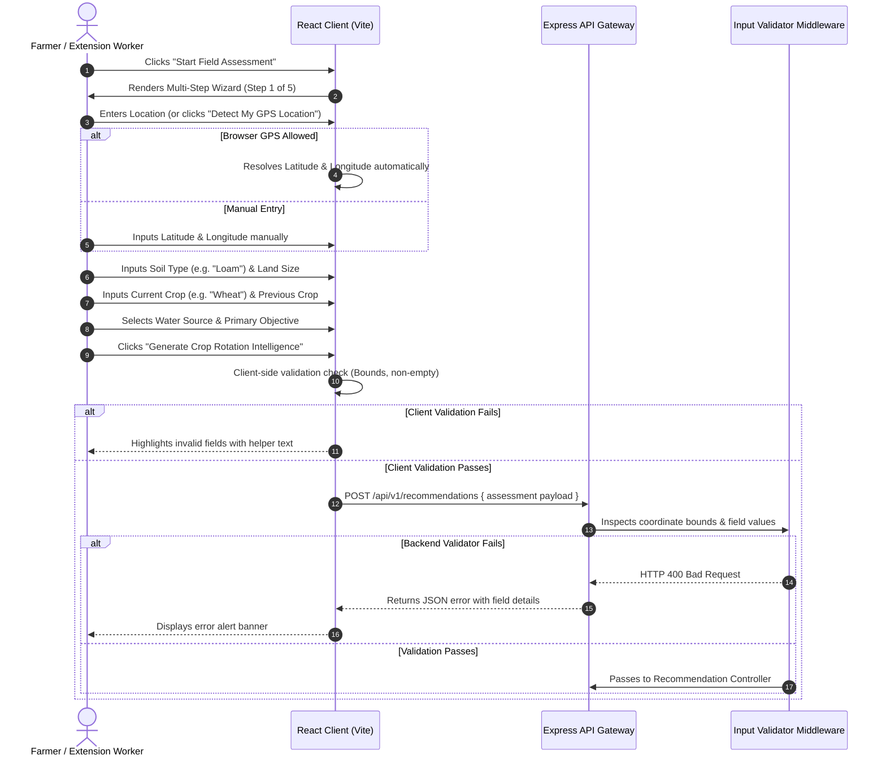
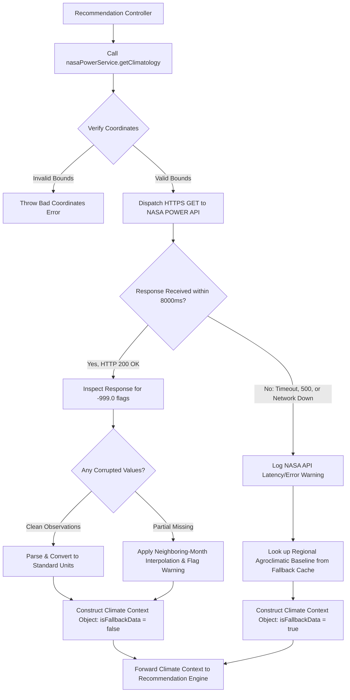
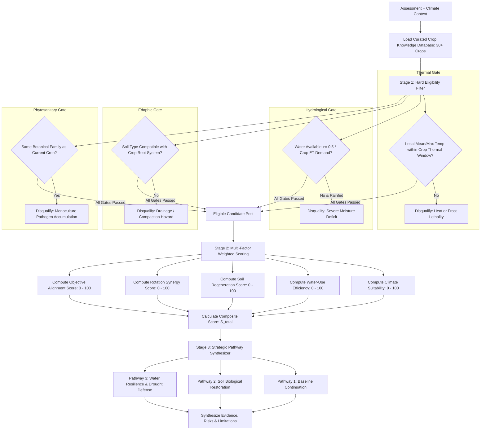
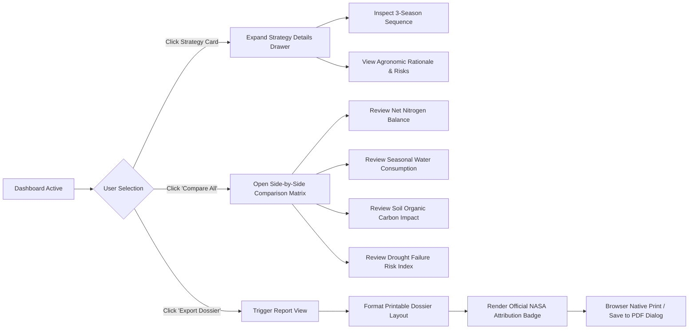

# 04 — User Flows & Interaction Models 🔀

This document maps out the end-to-end user journeys, decision nodes, and system interaction flows across **AgriShift**.

---

## 1. End-to-End User Journey Overview

---

## 2. Assessment Wizard Flow & Client Validation

---

## 3. NASA Climate Data Retrieval & Graceful Fallback Flow

---

## 4. Hybrid Recommendation Engine Flow

---

## 5. Strategy Comparison & Report Export Flow

