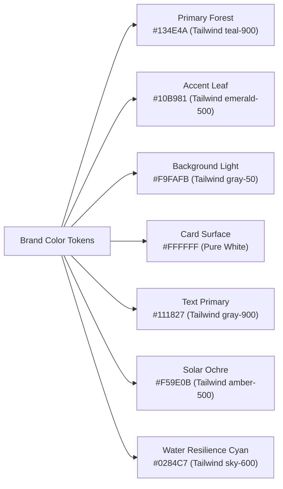

# 05 — UI/UX Requirements & Design System 🎨

---

## 1. Design Philosophy & Visual Identity

**AgriShift** is designed as a premier, modern agricultural SaaS intelligence platform. The user interface eschews the cluttered, antiquated look of typical government portals and generic admin dashboards in favor of a clean, nature-inspired, high-trust aesthetic.

The visual direction combines:
- **Deep Forest & Chlorophyll Greens**: Conveying vitality, agricultural growth, and scientific rigor.
- **Crisp Earth Neutrals & Soft Off-Whites**: Ensuring maximum legibility, reducing eye strain for outdoor field viewing.
- **Subtle Solar Ochre & Sky Cyan Accents**: Highlighting solar radiation, drought resilience, and satellite observation telemetry.
- **Generous Spacing & High Card Radius**: Modern 12px to 16px border-radius containers with delicate 1px border outlines and soft drop shadows.

---

## 2. Color Palette & Token System



| Token Name | Hex Code | Tailwind Utility | Functional Application |
| :--- | :--- | :--- | :--- |
| **`color-brand-deep`** | `#064E3B` | `emerald-900` | Header navigation, primary buttons, hero text |
| **`color-brand-primary`** | `#059669` | `emerald-600` | Active links, primary CTA highlights, positive indicators |
| **`color-brand-light`** | `#ECFDF5` | `emerald-50` | Badge backgrounds, active state fills, card highlights |
| **`color-surface-bg`** | `#F8FAFC` | `slate-50` | Global application background |
| **`color-surface-card`**| `#FFFFFF` | `white` | Content cards, modals, table rows |
| **`color-surface-border`**| `#E2E8F0` | `slate-200` | Card borders, table dividers, input borders |
| **`color-text-main`** | `#0F172A` | `slate-900` | Headings, primary metrics, high-emphasis text |
| **`color-text-muted`** | `#64748B` | `slate-500` | Subtitles, labels, scientific units, helper text |
| **`color-accent-amber`**| `#D97706` | `amber-600` | Solar radiation, warnings, baseline strategy badge |
| **`color-accent-sky`** | `#0284C7` | `sky-600` | Rainfall metrics, water resilience strategy badge |
| **`color-accent-rose`** | `#E11D48` | `rose-600` | Lethal temperature alerts, validation errors |

---

## 3. Typography Hierarchy

The typography utilizes a modern, legible sans-serif font family (**Inter** or **Plus Jakarta Sans** with clean system fallbacks: `-apple-system, BlinkMacSystemFont, 'Segoe UI', Roboto, sans-serif`).

| Level | Size / Rem | Weight | Line Height | Usage |
| :--- | :--- | :--- | :--- | :--- |
| **Display 1** | `2.5rem` (40px) | `700` (Bold) | `1.2` | Hero headline, main platform value proposition |
| **Heading 1** | `1.875rem` (30px) | `700` (Bold) | `1.25` | Page titles (Dashboard, Assessment, Methodology) |
| **Heading 2** | `1.5rem` (24px) | `600` (SemiBold) | `1.3` | Section headings, Strategy Card titles |
| **Heading 3** | `1.25rem` (20px) | `600` (SemiBold) | `1.4` | Chart titles, modal headers, subsection titles |
| **Body Large** | `1.125rem` (18px) | `400` / `500` | `1.5` | Lead paragraphs, card summaries |
| **Body Regular**| `1.0rem` (16px) | `400` (Normal) | `1.5` | Standard form inputs, explanatory paragraphs |
| **Body Small** | `0.875rem` (14px) | `400` / `500` | `1.4` | Table data, sub-score labels, card metadata |
| **Caption / Badge**| `0.75rem` (12px) | `600` (SemiBold) | `1.3` | NASA telemetry badges, confidence pills, tags |

---

## 4. Page Architecture & Navigation

The application consists of 6 primary views wrapped in a persistent, responsive layout:

```
[Sticky Navbar: Logo + Assessment CTA + Climate Dashboard + Methodology + NASA Badge]
───────────────────────────────────────────────────────────────────────────────────────
Page Content Area (Dynamic Route):
1. Landing Page (/)
2. Farmer Assessment Wizard (/assessment)
3. Climate & Intelligence Dashboard (/dashboard/:id)
4. Strategy Comparison Matrix (/compare)
5. Methodology & Data Sources (/methodology)
6. Printable Report Dossier (/report/:id)
───────────────────────────────────────────────────────────────────────────────────────
[Footer: NASA Attribution + FAO/USDA Citation + Open Source License + Space Apps 2026]
```

### 1. Landing Page (`/`)
- **Hero Section**: High-impact headline ("Satellite-Powered Crop Rotation for a Changing Climate"), dual CTAs ("Assess My Farm" and "Explore NASA Climate Data"), live telemetry badge.
- **The Agronomic Crisis in Numbers**: Interactive cards highlighting soil depletion, water loss, and thermal stress.
- **How AgriShift Works**: Three-step visual walkthrough (1. Ingest NASA Data $\rightarrow$ 2. Filter & Score $\rightarrow$ 3. Strategic Pathways).
- **The Three Pathways Preview**: Visual teaser for *Baseline*, *Soil Restoration*, and *Water Resilience*.
- **Scientific Foundation Banner**: Highlighting NASA POWER, FAO-56, and USDA NRCS backing.

### 2. Farmer Assessment Page (`/assessment`)
- **Multi-Step Form Container**: 5 progressive steps with breadcrumb progress tracker.
- **Geolocation Resolver**: One-click "Detect Location" button that populates coordinates and resolves country/region via reverse lookup.
- **Contextual Field Tooltips**: Explaining why soil texture and water source matter for recommendation accuracy.
- **Confidence Meter Preview**: Visual bar demonstrating how completing optional fields increases recommendation confidence from 75% to 100%.

### 3. Climate & Recommendation Dashboard (`/dashboard`)
- **Location & Environmental Banner**: Coordinates, altitude, aridity index, and live NASA status indicator.
- **Climatology Chart Section**: Tabbed Recharts views for "Temperature Envelope" and "Precipitation & Solar Radiation".
- **Three Strategy Cards**: Prominently featured side-by-side with recommended crop, expected soil benefits, water demands, and overall score gauge.
- **Granular Score Inspector**: Expandable breakdown for each crop (Climate, Water, Soil, Rotation, Objective).

### 4. Strategy Comparison Page (`/compare`)
- **Structured Matrix Table**: Detailed row-by-row trade-off comparison between Baseline, Soil Restoration, and Water Resilience across 10 agronomic indicators.
- **Recommendation Synthesis**: Clear guidance on which strategy to choose based on seasonal conditions.

### 5. Methodology & Data Sources (`/methodology`)
- Comprehensive scientific documentation detailing NASA POWER parameters, formulas, biological gating rules, and references.

### 6. Printable Report View (`/report/:id`)
- Clean, print-optimized document view with headers, data tables, strategy sequences, and NASA Langley Research Center attribution.

---

## 5. Component Hierarchy

```
App.jsx (Layout Wrapper, Router)
├── Navbar.jsx (Logo, Links, Satellite Telemetry Pill)
├── Main Content Outlet
│   ├── LandingPage.jsx
│   │   ├── HeroBanner.jsx
│   │   ├── CrisisMetrics.jsx
│   │   ├── HowItWorks.jsx
│   │   └── PathwayShowcase.jsx
│   ├── AssessmentPage.jsx
│   │   ├── WizardStepper.jsx
│   │   ├── GeoLocationPicker.jsx
│   │   ├── SoilCropSelector.jsx
│   │   └── ConfidenceMeter.jsx
│   ├── DashboardPage.jsx
│   │   ├── LocationHeader.jsx
│   │   ├── ClimatologyCharts.jsx (Recharts wrappers)
│   │   ├── StrategyCardGrid.jsx
│   │   │   └── StrategyCard.jsx (Score Badge, Sequence, Benefits, Risks)
│   │   └── ExplainabilityModal.jsx (Dossier, Math, Limitations)
│   ├── ComparisonPage.jsx
│   │   └── ComparisonMatrixTable.jsx
│   ├── MethodologyPage.jsx
│   └── ReportView.jsx
└── Footer.jsx (NASA Attribution, Disclaimers, Links)
```

---

## 6. Responsive Breakpoints & Device Adaptability

The layout is built mobile-first using standard Tailwind responsive breakpoints:
- **Mobile (`< 640px`)**: Single-column vertical stacks; sticky bottom action bar on assessment form; scrollable data tables; compact chart view with pinch/scroll tooltips.
- **Tablet (`640px - 1024px`)**: Two-column form layouts; 2-up card grids; full-width climatology graphs.
- **Desktop (`> 1024px`)**: Three-column strategy comparison grid; full interactive dual-axis Recharts visualizations; side-by-side filter and result panels.

---

## 7. States: Loading, Empty, and Error Handling

1. **Loading State**:
   - Instead of generic spinner circles, display animated telemetry cards: *"Connecting to NASA Langley Research Center POWER API..."* with pulsing satellite icon and progress steps.
   - Skeletons matching card dimensions to prevent layout shifts (CLS).
2. **Empty State**:
   - Friendly agricultural illustrations (e.g. seedling with clipboard) accompanied by actionable prompt: *"No field assessed yet. Start a 2-minute assessment to unlock NASA crop rotation intelligence."*
3. **Error State**:
   - Explicit distinction between user input errors (highlighted input borders with inline red text) and external service latency.
   - If NASA POWER times out: Display amber warning badge: *"Running on verified regional agroclimatic baseline (NASA POWER Live Connection Timeout)"* with a manual "Retry Live Telemetry" button.

---

## 8. Accessibility (a11y) Expectations

- **Contrast Ratios**: Minimum 4.5:1 contrast for body copy and 3:1 for large display text and UI boundaries (conforming to WCAG 2.1 AA standards).
- **Keyboard Navigation**: Full focus ring indicators (`ring-2 ring-emerald-500`) on all interactive buttons, selects, and links.
- **Screen Reader Support**: Meaningful `aria-label` attributes on charts, badges, and icon buttons.
- **Color Independence**: Statuses are never conveyed by color alone; every alert or badge couples color with an explicit icon and text label (e.g., Red ⚠️ Danger, Green ✅ Compatible, Amber ℹ️ Fallback).
