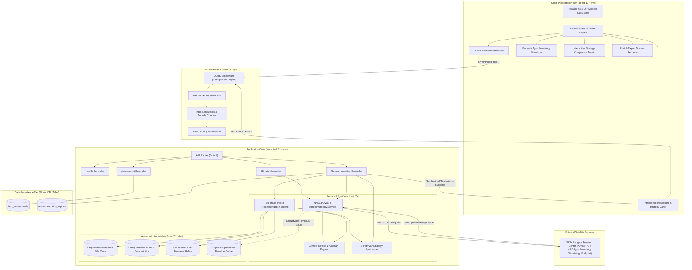
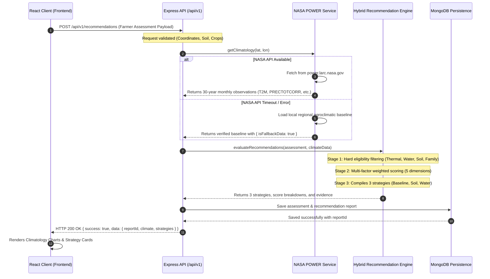
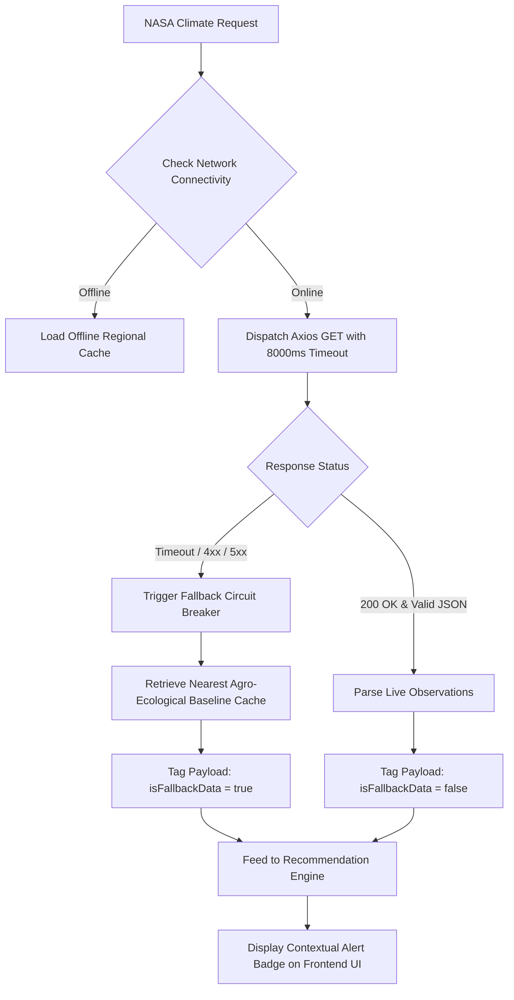

# 06 — System Architecture & Technical Design 🏛️

---

## 1. High-Level Architectural Blueprint

**AgriShift** employs a decoupled client-server architecture organized into distinct functional tiers. The frontend client (React + Vite) communicates with the backend API gateway (Node.js + Express) over secure REST protocols. The backend coordinates external NASA Earth Observation satellite services, executes the hybrid recommendation engine, and interfaces with the persistence layer.

---

## 2. Frontend / Backend Interaction Sequence

The following sequence details how the React frontend interacts with the Express backend during a complete assessment:

---

## 3. Module Responsibilities & Decoupling

The codebase is organized into isolated modules with clear boundaries to ensure that all 4 team members can develop, test, and maintain their code independently:

| Module / Layer | Primary Technologies | Key Files / Paths | Team Ownership | Core Invariants |
| :--- | :--- | :--- | :--- | :--- |
| **Frontend UI & Visuals** | React 19, Vite, Tailwind v4, Recharts, Lucide | `frontend/src/` | **Member 1 (Frontend)** | Never queries NASA API directly; routes all operations through backend gateway. |
| **Backend REST & Gateway** | Node.js, Express, Helmet, CORS, dotenv | `backend/src/app.js`, `backend/src/routes/`, `backend/src/middleware/` | **Member 2 (Backend)** | Validates all inputs; centralized error catching; standard JSON envelope. |
| **NASA Data Ingestion** | Axios, NASA POWER REST API | `backend/src/services/nasa/`, `backend/src/data/fallbackCache.js` | **Member 3 (NASA Data)** | Filters `-999.0` missing flags; standardizes units; transparent attribution. |
| **Recommendation Engine**| Pure Modular JavaScript Algorithms | `backend/src/services/recommendation/`, `backend/src/data/cropDatabase.js` | **Member 4 (Rec Engine)** | Stateless pure scoring function; outputs mathematical evidence for every recommendation. |

---

## 4. Graceful Degradation & Network Resilience Architecture

To prevent system lockups during unreliable network conditions, remote field deployments, or NASA server maintenance windows, AgriShift employs a multi-tiered resilience pattern:

1. **Timeout Circuit Breaker**: External NASA HTTP requests are wrapped with a strict 8-second timeout.
2. **Offline Regional Agroclimatic Baseline**: Pre-compiled, verified monthly profiles for major global agro-ecological zones (Semi-Arid Tropics, Subtropical Humid, Mediterranean, Continental Temperate).
3. **UI Transparency**: Whenever fallback data is activated, an explicit amber badge informs the user: *"Notice: Running on verified regional agroclimatic baseline (NASA POWER Live Telemetry Unreachable)"*.
