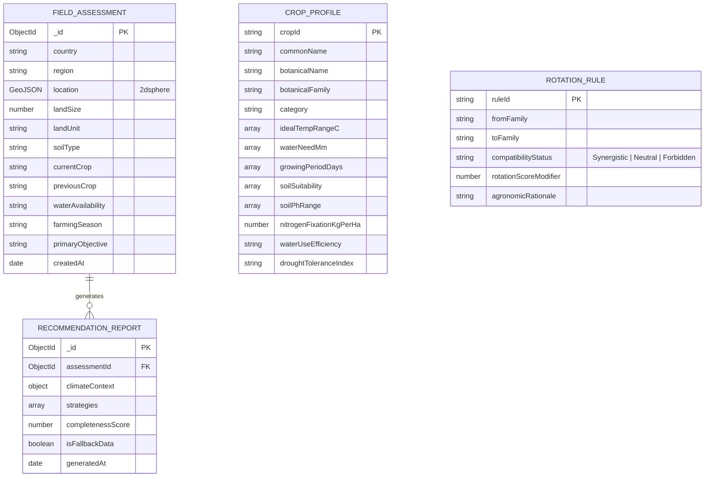

# 07 — Database Design & Schema Specifications 🗄️

---

## 1. Database Architectural Principles

**AgriShift** utilizes **MongoDB** as its primary persistence engine, interfacing through **Mongoose ODM**. The database schema is intentionally kept lean and purposeful for the hackathon MVP:
- **No Unnecessary User/Auth Tables**: In accordance with the project scope, no user authentication or session management is required for the initial MVP. Field assessments and recommendation reports are stored and indexed by unique identifiers.
- **Auditable & Reproducible**: Assessments and generated recommendation reports are stored with exact input snapshots and versioned algorithm outputs, enabling historical comparisons and verification.
- **Geospatial Indexing**: Coordinates are indexed using MongoDB 2dsphere indexing for efficient spatial queries.

---

## 2. Entity-Relationship Overview



---

## 3. Detailed Collection Schemas

### 3.1 `field_assessments` Collection
Stores farmer-submitted assessment records.

```javascript
const FieldAssessmentSchema = new mongoose.Schema({
  country: {
    type: String,
    required: [true, 'Country is required'],
    trim: true,
    index: true,
  },
  region: {
    type: String,
    required: [true, 'Region/State is required'],
    trim: true,
  },
  location: {
    type: {
      type: String,
      enum: ['Point'],
      default: 'Point',
      required: true,
    },
    coordinates: {
      type: [Number], // [longitude, latitude] in GeoJSON format
      required: [true, 'Coordinates are required: [longitude, latitude]'],
      validate: {
        validator: function(coords) {
          const [lon, lat] = coords;
          return lon >= -180 && lon <= 180 && lat >= -90 && lat <= 90;
        },
        message: 'Coordinates must be valid: longitude (-180 to 180), latitude (-90 to 90)'
      }
    }
  },
  landSize: {
    type: Number,
    required: [true, 'Land size is required'],
    min: [0.1, 'Land size must be greater than zero'],
  },
  landUnit: {
    type: String,
    required: [true, 'Land unit is required'],
    enum: ['acres', 'hectares', 'kanals', 'bighas'],
    default: 'acres',
  },
  soilType: {
    type: String,
    required: [true, 'Soil type is required'],
    enum: ['Clay', 'Clay Loam', 'Loam', 'Sandy Loam', 'Sandy', 'Silt Loam'],
  },
  currentCrop: {
    type: String,
    required: [true, 'Current crop is required'],
    trim: true,
  },
  previousCrop: {
    type: String,
    default: null,
    trim: true,
  },
  waterAvailability: {
    type: String,
    required: [true, 'Water availability is required'],
    enum: [
      'Abundant (Canal + Tubewell)',
      'Moderate (Tubewell)',
      'Constrained (Rationed)',
      'Rainfed Only'
    ],
  },
  farmingSeason: {
    type: String,
    required: [true, 'Farming season is required'],
    enum: ['Summer / Kharif', 'Winter / Rabi', 'Spring / Zaid', 'Year-Round'],
  },
  primaryObjective: {
    type: String,
    required: [true, 'Primary objective is required'],
    enum: [
      'Maximum Yield & Economic Profit',
      'Soil Restoration & Fertility',
      'Water Conservation & Drought Defense'
    ],
  },
  completenessScore: {
    type: Number,
    min: 0,
    max: 1,
    default: 1.0,
  }
}, {
  timestamps: true,
});

// Indexes
FieldAssessmentSchema.index({ location: '2dsphere' });
FieldAssessmentSchema.index({ createdAt: -1 });
```

---

### 3.2 `recommendation_reports` Collection
Stores generated rotation plans, score breakdowns, and NASA observation summaries.

```javascript
const StrategySchema = new mongoose.Schema({
  id: {
    type: String,
    required: true,
    enum: ['baseline_continuation', 'soil_restoration', 'water_resilience'],
  },
  title: { type: String, required: true },
  tagline: { type: String, required: true },
  recommendedNextCrop: { type: String, required: true },
  subsequentSequence: [{ type: String }],
  overallScore: { type: Number, min: 0, max: 100, required: true },
  scoreBreakdown: {
    climateMatch: { type: Number, min: 0, max: 100 },
    waterMatch: { type: Number, min: 0, max: 100 },
    soilRegeneration: { type: Number, min: 0, max: 100 },
    rotationSynergy: { type: Number, min: 0, max: 100 },
    objectiveAlignment: { type: Number, min: 0, max: 100 },
  },
  soilImpact: { type: String, required: true },
  waterConsideration: { type: String, required: true },
  climateCompatibility: { type: String, required: true },
  risks: [{ type: String }],
  evidenceSummary: { type: String, required: true },
  confidenceLevel: { type: String, enum: ['High', 'Moderate', 'Limited Data'], required: true },
  limitations: { type: String, required: true },
}, { _id: false });

const RecommendationReportSchema = new mongoose.Schema({
  assessmentId: {
    type: mongoose.Schema.Types.ObjectId,
    ref: 'FieldAssessment',
    required: true,
    index: true,
  },
  climateContext: {
    source: { type: String, default: 'NASA POWER Agroclimatology (v2.0)' },
    coordinates: {
      latitude: { type: Number, required: true },
      longitude: { type: Number, required: true },
    },
    climatologySummary: {
      annualMeanTempC: Number,
      annualPrecipitationMm: Number,
      solarRadiationAvg: Number,
      humidityAvg: Number,
      aridityClassification: String,
    },
    monthlySeries: [{
      month: String,
      tempMeanC: Number,
      tempMaxC: Number,
      tempMinC: Number,
      precipMm: Number,
      solarRadiation: Number,
      relativeHumidity: Number,
    }],
    isFallbackData: { type: Boolean, default: false },
  },
  eligibleCropsEvaluated: { type: Number, default: 0 },
  strategies: [StrategySchema],
}, {
  timestamps: true,
});

RecommendationReportSchema.index({ createdAt: -1 });
```

---

### 3.3 Curated Agricultural Knowledge Schema (In-Memory / Seedable)
Crops and rotation rules can be stored in MongoDB or maintained in version-controlled JS data files (`cropDatabase.js` and `rotationRules.js`) for maximum engine performance.

```javascript
const CropProfileSchema = new mongoose.Schema({
  cropId: { type: String, required: true, unique: true },
  commonName: { type: String, required: true },
  botanicalName: { type: String, required: true },
  family: { type: String, required: true, index: true },
  category: {
    type: String,
    enum: ['Cereal', 'Legume', 'Oilseed', 'Fiber', 'Tuber/Root', 'Forage'],
    required: true,
  },
  idealTempRangeC: {
    min: { type: Number, required: true },
    max: { type: Number, required: true },
    optimum: { type: Number, required: true },
  },
  waterNeedMm: {
    min: { type: Number, required: true },
    max: { type: Number, required: true },
  },
  growingPeriodDays: {
    min: { type: Number, required: true },
    max: { type: Number, required: true },
  },
  soilSuitability: [{ type: String }],
  soilPhRange: {
    min: { type: Number, default: 5.5 },
    max: { type: Number, default: 8.2 },
  },
  nitrogenFixationKgPerHa: { type: Number, default: 0 },
  rootArchitecture: {
    type: String,
    enum: ['Deep Taproot', 'Fibrous Shallow', 'Medium Branched', 'Tuberous'],
  },
  waterUseEfficiency: {
    type: String,
    enum: ['Very High', 'High', 'Medium', 'Low'],
  },
  droughtToleranceIndex: {
    type: String,
    enum: ['Exceptional', 'High', 'Moderate', 'Sensitive'],
  },
});
```

---

## 4. Indexing Strategy & Performance Considerations

1. **2dsphere Spatial Indexing**:
   - `location: "2dsphere"` on `field_assessments` allows querying assessments within geographical radii or administrative polygon boundaries.
2. **Compound Index on Coordinates & Dates**:
   - Supports rapid lookup of previously retrieved climate contexts to minimize redundant external NASA POWER API calls.
3. **Lean Payload Design**:
   - Sub-documents (`strategies`) are embedded directly within `recommendation_reports`, eliminating expensive multi-table `$lookup` operations during report rendering.
