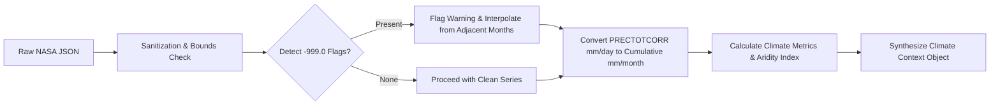
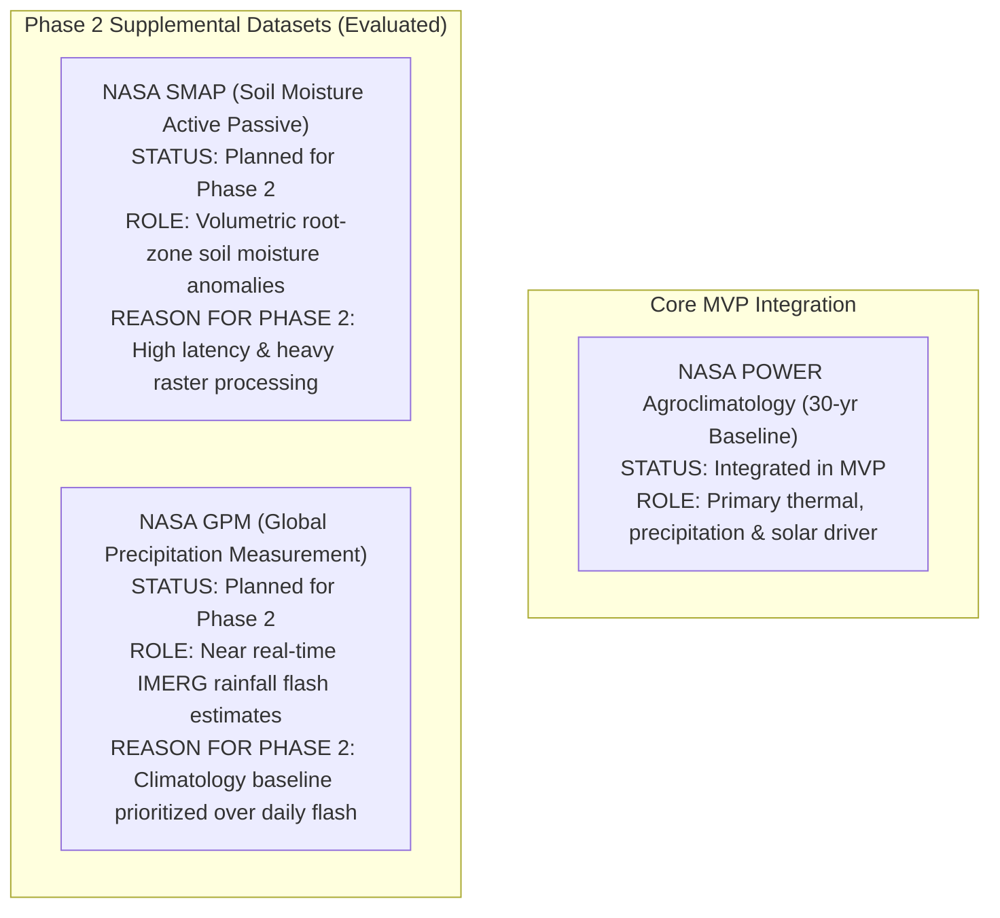

# 09 — NASA Earth Observation Data Integration 🛰️

---

## 1. Primary Dataset: NASA POWER Project

### 1.1 Overview & Scientific Background
AgriShift integrates the **NASA Prediction Of Worldwide Energy Resources (POWER)** Project, funded by the NASA Earth Science / Applied Science Program and hosted at the **NASA Langley Research Center (LaRC)**.

NASA POWER provides tailored solar and meteorological datasets derived from satellite observations and global assimilation models (specifically NASA GMAO MERRA-2 and GEOS FP-IT atmospheric models, alongside satellite-derived solar radiation from CERES and FLASHFlux).

- **Official Web Portal**: [https://power.larc.nasa.gov/](https://power.larc.nasa.gov/)
- **Documentation Portal**: [https://power.larc.nasa.gov/docs/services/api/](https://power.larc.nasa.gov/docs/services/api/)
- **API Base Endpoint**: `https://power.larc.nasa.gov/api/temporal/climatology/point`
- **Application Community**: `community=AG` (Agroclimatology)
- **Authentication**: Open Public Access (No API key required; rate limits respected).

---

## 2. Ingested Climatological Parameters

AgriShift extracts six essential agronomic parameters across a 30-year multi-decadal climatology:

| Parameter ID | Parameter Name | Units | Temporal Granularity | Agronomic Significance |
| :--- | :--- | :--- | :--- | :--- |
| **`T2M`** | Temperature at 2 Meters | °C | Monthly Climatology | Base thermal window; crop phenological progress |
| **`T2M_MAX`** | Maximum Temperature at 2 Meters | °C | Monthly Climatology | Thermal stress; pollen sterility & anthesis failure risks |
| **`T2M_MIN`** | Minimum Temperature at 2 Meters | °C | Monthly Climatology | Frost risk; chilling hour accumulation; germination limits |
| **`PRECTOTCORR`** | Corrected Total Precipitation | mm/day $\rightarrow$ mm/mo | Monthly Climatology | Seasonal water supply; irrigation deficit calculation |
| **`ALLSKY_SFC_SW_DWN`**| All Sky Surface Downward Solar Radiation | $MJ/m^2/day$ | Monthly Climatology | Photosynthetically Active Radiation (PAR) & biomass yield |
| **`RH2M`** | Relative Humidity at 2 Meters | % | Monthly Climatology | Vapor pressure deficit (VPD); fungal pathogen pressure |

---

## 3. API Query Specification & Request Syntax

### Live Climatology Query Syntax
```http
GET /api/temporal/climatology/point?parameters=T2M,T2M_MAX,T2M_MIN,PRECTOTCORR,ALLSKY_SFC_SW_DWN,RH2M&community=AG&longitude=74.3587&latitude=31.5204&format=JSON HTTP/1.1
Host: power.larc.nasa.gov
User-Agent: AgriShift-SpaceApps/1.0
Accept: application/json
```

### JSON Response Structure (Sample from Live Endpoint)
```json
{
  "type": "Feature",
  "geometry": {
    "type": "Point",
    "coordinates": [74.3587, 31.5204, 214.0]
  },
  "properties": {
    "parameter": {
      "T2M": {
        "JAN": 12.38, "FEB": 15.62, "MAR": 21.05, "APR": 27.81,
        "MAY": 32.74, "JUN": 34.61, "JUL": 32.14, "AUG": 30.82,
        "SEP": 29.35, "OCT": 25.12, "NOV": 19.24, "DEC": 13.91,
        "ANN": 23.82
      },
      "PRECTOTCORR": {
        "JAN": 0.74, "FEB": 1.12, "MAR": 1.25, "APR": 0.95,
        "MAY": 0.82, "JUN": 2.15, "JUL": 5.89, "AUG": 5.12,
        "SEP": 2.45, "OCT": 0.45, "NOV": 0.28, "DEC": 0.48,
        "ANN": 1.81
      }
      // ... T2M_MAX, T2M_MIN, ALLSKY_SFC_SW_DWN, RH2M
    }
  },
  "messages": []
}
```

---

## 4. Processing Pipeline & Data Quality Controls



1. **Missing Data Flag Detection**: NASA POWER represents missing, non-computable, or uncalibrated values with `-999.0`. AgriShift strictly parses all parameters; any occurrence of `-999.0` triggers an automatic data repair pass (adjacent month average) and emits an alert in the audit log.
2. **Cumulative Precipitation Conversion**:
   $$\text{Precipitation}_{\text{month}} (mm) = \text{PRECTOTCORR}_{\text{avg}} (mm/\text{day}) \times \text{DaysInMonth}$$
   *(e.g., July with $5.89\text{ mm/day} \times 31\text{ days} = 182.59\text{ mm}$).*
3. **Aridity Index ($AI$) Calculation**:
   $$AI = \frac{\text{Annual Precipitation}}{\text{Potential Evapotranspiration (PET)}}$$
   Categorized according to UNEP standards: Hyper-Arid ($< 0.05$), Arid ($0.05 - 0.20$), Semi-Arid ($0.20 - 0.50$), Dry Sub-Humid ($0.50 - 0.65$), Humid ($> 0.65$).

---

## 5. Supplementary NASA Datasets: Evaluation & Roadmap

Beyond NASA POWER, two additional Earth Observation missions were formally evaluated for crop rotation modeling:



### 5.1 NASA SMAP (Soil Moisture Active Passive)
- **Source**: NASA JPL / Goddard Space Flight Center.
- **Parameters**: Surface ($0-5\text{ cm}$) and Root-Zone ($0-100\text{ cm}$) Volumetric Soil Moisture ($m^3/m^3$).
- **Feasibility Evaluation**: SMAP provides exceptional radar/radiometer measurements of soil wetness at 9km to 36km resolution. However, SMAP Level 3/4 products require HDF5/GeoTIFF raster processing pipelines that exceed hackathon client-server latency budgets.
- **Status in AgriShift**: Planned for Phase 2 via NASA Earthdata CMR API; in MVP, soil moisture is estimated using NASA POWER precipitation and soil texture water-holding capacities.

### 5.2 NASA GPM (Global Precipitation Measurement)
- **Source**: NASA Goddard Space Flight Center / JAXA.
- **Parameters**: GPM IMERG Near Real-Time Precipitation ($mm/hr$).
- **Feasibility Evaluation**: GPM IMERG offers high-frequency rainfall estimates (every 30 minutes at $0.1^\circ \times 0.1^\circ$). While vital for flash-flood tracking, multi-season strategic crop rotation requires 30-year climatological distributions rather than 30-minute flash forecasts.
- **Status in AgriShift**: Planned as a Phase 2 real-time planting window extension; NASA POWER's 30-year precipitation climatology is prioritized for the core MVP rotation engine.

---

## 6. Official NASA Attribution Standard

In accordance with NASA Earth Science Division guidelines and the NASA POWER Data Use Policy, all dashboards, UI cards, and exportable PDF dossiers generated by AgriShift feature the following mandatory attribution:

> **Data Attribution**: *"Meteorological and solar radiation data obtained from the NASA Langley Research Center (LaRC) POWER Project funded through the NASA Earth Science / Applied Science Program."*
> **Reference**: Stackhouse, P. W., et al., NASA POWER Agroclimatology Methodology (v2.0), NASA Langley Research Center.
