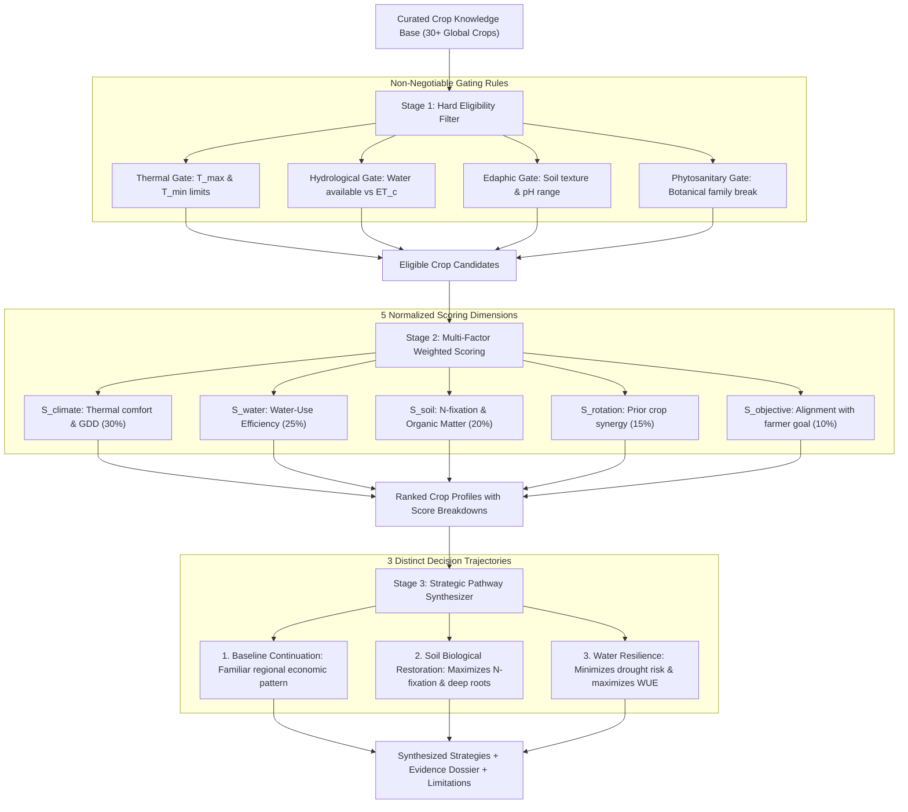

# 10 — Hybrid Recommendation Engine & Agronomic Methodology 🔬

---

## 1. Engine Architecture & Two-Stage Philosophy

Agricultural systems are biologically complex, non-linear, and sensitive to environmental thresholds. Unconstrained machine learning models and generative LLMs frequently produce hazardous recommendations—such as planting frost-intolerant species into freezing weather or planting nightshades (*Solanaceae*) sequentially, concentrating *Fusarium* and nematode infestations.

To eliminate biological hallucinations and ensure transparent decision-making, **AgriShift** implements a **Two-Stage Hybrid Recommendation Architecture**:
1. **Stage 1 (Agronomic Rule-Based Eligibility Filter)**: Applies non-negotiable biological and environmental constraints to eliminate unviable crops.
2. **Stage 2 (Multi-Factor Weighted Scoring & Optimization)**: Scores and ranks surviving eligible candidates across five normalized agronomic dimensions.
3. **Stage 3 (Strategic Pathway Compilation)**: Assembles scored candidates into three distinct, explainable multi-season rotation roadmaps (*Baseline Continuation*, *Soil Restoration*, *Water Resilience*).



---

## 2. Curated Crop Knowledge Schema

The knowledge base contains 30+ globally significant crops spanning 5 agricultural categories:

```javascript
{
  cropId: "chickpea",
  commonName: "Chickpea (Gram)",
  botanicalName: "Cicer arietinum",
  family: "Fabaceae",
  category: "Legume",
  idealTempRangeC: { min: 10, max: 32, optimum: 22 },
  waterNeedMm: { min: 250, max: 400 },
  growingPeriodDays: { min: 90, max: 120 },
  soilSuitability: ["Loam", "Sandy Loam", "Clay Loam", "Silt Loam"],
  soilPhRange: { min: 6.0, max: 8.0 },
  nitrogenFixationKgPerHa: 45, // Biological nitrogen fixation
  rootArchitecture: "Deep Taproot", // Breaks subsoil compaction
  waterUseEfficiency: "High",
  droughtToleranceIndex: "High",
  carbonNitrogenRatio: "Low (Rapid decomposition)",
  pestVulnerabilities: ["Helicoverpa armigera", "Ascochyta blight"]
}
```

---

## 3. Stage 1 — Hard Eligibility Filtering

A crop candidate must pass all four criteria. If any gate fails, the crop is eliminated and the specific rejection reason is logged for explainability.

### Gate 1: Thermal Compatibility
NASA POWER provides seasonal temperature extremes ($T_{\min}$, $T_{\max}$, and $T_{\text{mean}}$):
- **Rule**: If $T_{\max\text{, local}} > T_{\max\text{, lethal}}$ OR $T_{\min\text{, local}} < T_{\min\text{, base}}$, the crop is **Disqualified**.
- *Example*: Chickpea pollen aborts above 32°C; if summer temperatures average 38°C, chickpea is eliminated for that season.

### Gate 2: Hydrological Feasibility
Calculates effective water availability ($W_{\text{avail}} = P_{\text{NASA}} + I_{\text{irrigation}}$) against crop seasonal evapotranspiration requirements ($ET_c$):
- **Rule**: If $W_{\text{avail}} < 0.5 \times ET_{c\text{, min}}$ AND water source is "Rainfed Only", the crop is **Disqualified** to protect the farmer from catastrophic drought loss.

### Gate 3: Edaphic (Soil) Tolerance
Evaluates soil texture (Sandy, Loam, Clay, etc.) and pH compatibility:
- **Rule**: If the field soil type is absent from the crop's `soilSuitability` list, the crop is **Disqualified**.
- *Example*: Peanuts/Groundnuts require loose sandy/loamy soils for peg penetration; planting in heavy cracking Vertisol clays results in pod rot and harvest failure.

### Gate 4: Botanical Family Rotation Safety (Phytosanitary Break)
To disrupt pest cycles, nematodes, and soil-borne pathogens:
- **Rule**: If `candidate.family === currentCrop.family`, the crop is **Disqualified** (or penalized by 90% in mono-crop emergency modes).
- *Forbidden Sequences*:
  - *Solanaceae* $\rightarrow$ *Solanaceae* (Blight, *Fusarium*, Root-knot nematodes)
  - *Fabaceae* $\rightarrow$ *Fabaceae* (Rhizoctonia root rot, *Aphanomyces*)
  - *Brassicaceae* $\rightarrow$ *Brassicaceae* (Clubroot *Plasmodiophora brassicae*)

---

## 4. Stage 2 — Multi-Factor Weighted Scoring

Surviving candidates receive a composite suitability score $S_{\text{total}} \in [0, 100]$:

$$S_{\text{total}} = w_c \cdot S_{\text{climate}} + w_w \cdot S_{\text{water}} + w_s \cdot S_{\text{soil}} + w_r \cdot S_{\text{rotation}} + w_o \cdot S_{\text{objective}}$$

### Default Weight Configuration:
- Climate Compatibility ($w_c$): **0.30**
- Water-Use Efficiency & Match ($w_w$): **0.25**
- Soil Regeneration & Organic Matter ($w_s$): **0.20**
- Rotation Synergy ($w_r$): **0.15**
- Farmer Objective Priority ($w_o$): **0.10**

*(Weights adjust dynamically if the farmer selects a specialized objective: e.g. Soil Restoration shifts $w_s \rightarrow 0.35$).*

### Sub-Score Formulations

#### 1. Climate Suitability Score ($S_{\text{climate}}$)
Measures closeness of local NASA temperatures to the crop's physiological optimum:
$$S_{\text{climate}} = \max\left(0, 100 \times \left(1 - \frac{|T_{\text{mean, NASA}} - T_{\text{optimum}}|}{T_{\text{optimum}} - T_{\min}}\right)\right)$$

#### 2. Water Compatibility Score ($S_{\text{water}}$)
Rewards adequate moisture matching while penalizing deficit or waterlogging:
$$S_{\text{water}} = \min\left(100, 100 \times \frac{W_{\text{avail}}}{ET_{c\text{, demand}}}\right) \times \mu_{\text{WUE}}$$
where $\mu_{\text{WUE}}$ is a bonus factor ($1.0$ for C3, $1.2$ for drought-tolerant C4 species).

#### 3. Soil Regeneration Score ($S_{\text{soil}}$)
Quantifies biological contribution to the rhizosphere:
- Biological Nitrogen Fixation ($N_{\text{fix}}$): $+40\text{ points}$ (for nodulating Fabaceae legumes).
- Biomass contribution to Soil Organic Matter: Up to $+30\text{ points}$.
- Root architecture score (Deep taproots breaking compaction): Up to $+30\text{ points}$.

#### 4. Rotation Synergy Score ($S_{\text{rotation}}$)
- Prior crop was Cereal $\rightarrow$ Next crop is Legume: **100 points** (Nitrogen recharge).
- Prior crop was Legume $\rightarrow$ Next crop is High-N Cereal (Maize/Wheat): **95 points** (Utilizes fixed N).
- Prior crop was Deep-Rooted $\rightarrow$ Next crop is Shallow-Rooted: **85 points** (Stratified nutrient extraction).
- Different family, neutral allelopathy: **75 points**.

#### 5. Farmer Objective Score ($S_{\text{objective}}$)
Directly scores alignment with stated farm priorities (Economic Yield, Soil Rebuilding, or Drought Defense).

---

## 5. Stage 3 — The Three Strategic Rotation Pathways

Rather than offering an inflexible, singular recommendation, AgriShift compiles three distinct pathways:

| Feature | Strategy 1: Baseline Continuation | Strategy 2: Soil Restoration | Strategy 3: Water Resilience |
| :--- | :--- | :--- | :--- |
| **Philosophical Goal** | Conventional economic familiarity | Rebuilding soil biology & nitrogen | Minimizing drought & water failure |
| **Target Crop Type** | High-demand regional cash staple | Biological N-fixing legume / cover crop | High WUE C4 cereal / drought pulse |
| **Typical 3-Season Sequence** | Cereal $\rightarrow$ Cash Staple $\rightarrow$ Cereal | Cereal $\rightarrow$ **Legume** $\rightarrow$ Restorative Pulse | Cereal $\rightarrow$ **C4 Millet/Sorghum** $\rightarrow$ Oilseed |
| **Soil N Impact** | Depletive (requires synthetic urea) | **Net Positive (+40 to +60 kg N/ha)** | Neutral (conserves moisture & OM) |
| **Water Demand** | Moderate to High ($600 - 800\text{ mm}$) | Low to Moderate ($250 - 400\text{ mm}$) | **Minimal ($200 - 350\text{ mm}$)** |
| **Primary Risk** | High input costs; groundwater drawdown | Waterlogging if heavy rains hit harvest | Lower spot-market trading price |

---

## 6. Recommendation Confidence Formulation

Each recommendation report outputs a transparent **Confidence Rating** calculated as:

$$\text{Confidence Score} = 0.40 \cdot C_{\text{coords}} + 0.35 \cdot C_{\text{soil}} + 0.25 \cdot C_{\text{history}}$$
- **High ($\ge 85\%$)**: Exact coordinates provided, soil type verified, prior crop specified.
- **Moderate ($65\% - 84\%$)**: Region coordinates used, default soil assumption applied.
- **Limited Data ($< 65\%$)**: Missing rotation history, fallback regional baseline active.

---

## 7. Scientific Disclaimers & Integrity Standards

1. **Comparative Indicators, Not Yield Guarantees**: Scores ($0-100$) represent relative agronomic suitability, not guaranteed crop yields. Unmodeled micro-climates, hail storms, seed germination rates, and farm management practices can impact yields.
2. **Attribution to Literature**: Grounded in published FAO Irrigation and Drainage Paper 56, USDA NRCS Soil Health Technical Notes, and international crop physiology research.
