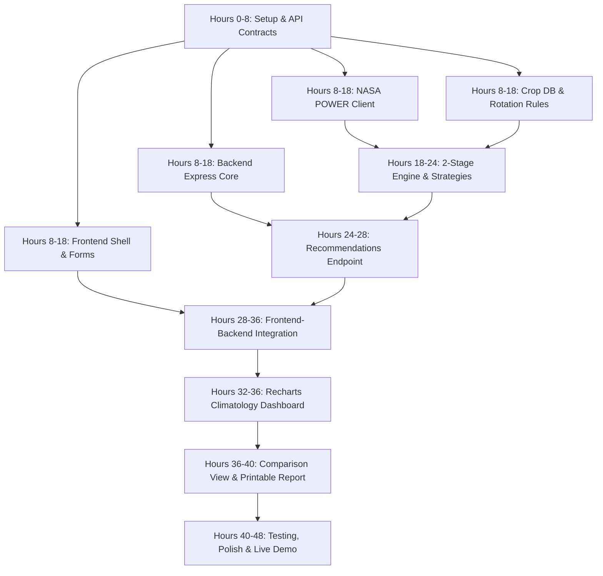

# 12 — Two-Day Hackathon Development Roadmap ⏱️

This document outlines a realistic, 48-hour development plan for the four team members to build, test, and demonstrate **AgriShift** for the NASA Space Apps Challenge 2026.

---

## 1. 48-Hour High-Level Schedule

```mermaid
gantt
    title AgriShift 48-Hour Hackathon Execution Roadmap
    dateFormat  HH
    axisFormat %H:00

    section Foundation & Scaffolding
    Project Setup & Git Foundation (All)       :done,    h00, 4h
    API Contracts & Documentation (All)       :done,    h04, 4h

    section Core Engines (Parallel)
    NASA POWER Integration (Member 3)         :active,  h08, 10h
    Crop Knowledge Base & Rules (Member 4)    :active,  h08, 8h
    Backend Core & DB Models (Member 2)       :active,  h08, 8h
    Frontend Design System & Layout (Member 1):active,  h08, 10h

    section Business Logic & UI
    Hybrid Recommendation Engine (Member 4)   :         h16, 12h
    Assessment Wizard & Forms (Member 1)      :         h18, 10h
    Express Routes & Controllers (Member 2)   :         h16, 10h
    Climate Analytics & Fallback (Member 3)   :         h18, 8h

    section Integration
    Backend-Engine-NASA Wireup (M2, M3, M4)   :         h26, 8h
    Frontend-Backend Full API Connect (M1, M2):         h28, 8h
    Climatology Charts & Recharts (Member 1)  :         h28, 8h

    section Polish & Verification
    End-to-End Testing & Bug Fixing (All)     :         h36, 6h
    Strategy Comparison & Report View (M1, M2):         h36, 6h
    Demo Rehearsal & Pitch Scripting (All)    :         h42, 6h
```

---

## 2. Granular Milestone Breakdown

### Day 1: Hours 00:00 – 12:00 (Foundation & Parallel Module Starts)

| Time Window | Workstream | Primary Deliverables | Owner |
| :--- | :--- | :--- | :--- |
| **00:00 – 04:00** | Project Setup & Monorepo | Monorepo structure, Git repository, `.gitignore`, `.env.example`, Tailwind v4 config | **All Members** |
| **04:00 – 08:00** | Architectural Contracts | API specifications, database design, feature documentation, and verification checks | **All Members** |
| **08:00 – 12:00** | Frontend Track | Navbar, Footer, layout shell, color token verification, responsive container | **Member 1** |
| **08:00 – 12:00** | Backend Track | Express app structure, `/health` endpoint, Mongoose database connection setup | **Member 2** |
| **08:00 – 12:00** | NASA Data Track | Axios client querying `power.larc.nasa.gov`, raw JSON parsing, -999.0 detection | **Member 3** |
| **08:00 – 12:00** | Agronomy Track | 30+ crop profiles authored (`cropDatabase.js`), botanical family matrix created | **Member 4** |

---

### Day 1: Hours 12:00 – 24:00 (Logic Implementation & UI Construction)

| Time Window | Workstream | Primary Deliverables | Owner |
| :--- | :--- | :--- | :--- |
| **12:00 – 18:00** | Frontend Track | Multi-step Farmer Assessment wizard (`FarmerAssessmentForm.jsx`), geolocation input | **Member 1** |
| **12:00 – 18:00** | Backend Track | Assessment & Recommendation controllers, validation middleware (`express-validator`) | **Member 2** |
| **12:00 – 18:00** | NASA Data Track | Monthly unit conversions, aridity index calculation, offline regional fallback cache | **Member 3** |
| **12:00 – 18:00** | Agronomy Track | Stage 1 hard eligibility filters (Thermal comfort, water threshold, soil, family) | **Member 4** |
| **18:00 – 24:00** | Frontend Track | Strategy cards UI (`StrategyCard.jsx`), score badges, loading telemetry skeleton | **Member 1** |
| **18:00 – 24:00** | Backend / Engine | Stage 2 weighted scoring algorithm ($S_{\text{total}}$) & 3-pathway strategy compilation | **Member 4 & M2** |

---

### Day 2: Hours 24:00 – 36:00 (System Integration & Dashboards)

| Time Window | Workstream | Primary Deliverables | Owner |
| :--- | :--- | :--- | :--- |
| **24:00 – 28:00** | Service Wireup | Wire `nasaPowerService` and `recommendationEngine` into Express recommendation route | **Member 2, 3, 4** |
| **28:00 – 32:00** | Client API Integration | Connect React frontend to `POST /api/v1/recommendations`, handle real responses | **Member 1 & M2** |
| **32:00 – 36:00** | Visual Climatology | Recharts integration: Temperature envelope and precipitation/solar radiation curves | **Member 1** |
| **32:00 – 36:00** | Persistence Integration| Save completed assessments and recommendation reports to MongoDB | **Member 2** |

---

### Day 2: Hours 36:00 – 48:00 (Verification, Polish & Hackathon Demo)

| Time Window | Workstream | Primary Deliverables | Owner |
| :--- | :--- | :--- | :--- |
| **36:00 – 40:00** | Strategy Comparison | Side-by-side comparison matrix (`ComparisonPage.jsx`), trade-off indicators | **Member 1 & M4** |
| **36:00 – 40:00** | Testing & Edge Cases | Automated test suite execution (NASA timeout, invalid coordinates, boundary tests) | **Member 2 & M3** |
| **40:00 – 44:00** | Report Export & Polish | Printable report styling (`/report/:id`), responsive UI audit, mobile styling check | **Member 1** |
| **44:00 – 48:00** | Hackathon Demo Rehearsal| Live end-to-end demonstration run, slide preparation, pitch timing practice | **All Members** |

---

## 3. Critical Path & Dependency Management



### Risk & Blocker Mitigation Strategies:
1. **NASA API Outage or Rate Limiting**:
   - *Risk*: External NASA API becomes unresponsive during testing or live judging.
   - *Mitigation*: Member 3 provides `fallbackCache.js` with pre-cached real NASA profiles for diverse global regions.
2. **Frontend Waiting for Backend Endpoints**:
   - *Risk*: Frontend developer is blocked waiting for API routes.
   - *Mitigation*: Member 1 uses mock JSON data matching `docs/08-API-SPECIFICATIONS.md` until Hour 28 wireup.
3. **Agronomic Disagreements on Crop Rules**:
   - *Risk*: Team debate over specific crop temperature thresholds stalls development.
   - *Mitigation*: Member 4 has sole authority over `cropDatabase.js` based strictly on FAO-56 and USDA literature.
