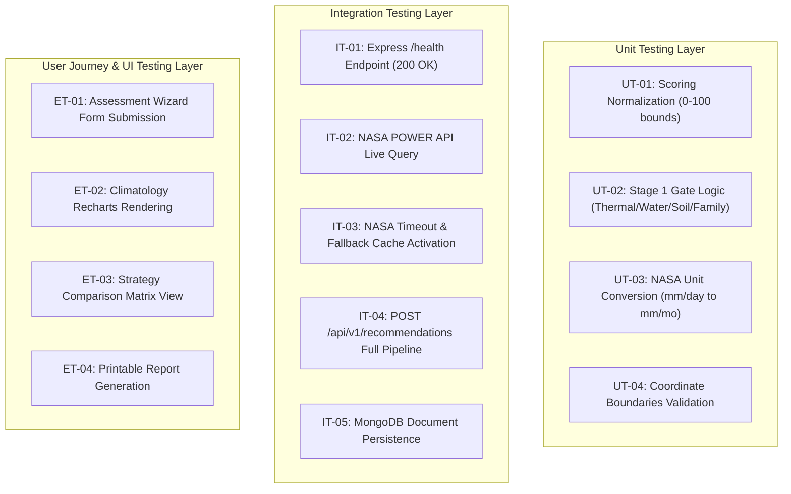

# 13 — Testing Strategy & Validation Protocols 🧪

---

## 1. Quality Assurance Philosophy

To ensure that **AgriShift** operates reliably under live judging, remote field conditions, and unpredictable network environments, testing is embedded into each phase of development. The testing strategy covers:
1. **Unit Testing**: Isolated verification of mathematical scoring formulas, coordinate boundary checks, and agronomic filter gates.
2. **Integration Testing**: End-to-end verification of Express routes, MongoDB persistence, and NASA POWER API ingestion.
3. **Resilience & Fallback Validation**: Verifying that API timeouts, negative NASA flags (`-999.0`), and network drops degrade gracefully.
4. **Client UI Verification**: Form validation, chart rendering, and responsive behavior across screen sizes.

---

## 2. Test Execution Matrix



---

## 3. Granular Test Scenarios & Acceptance Criteria

### Test Scenario 1: Coordinate Boundary Validation
- **Test ID**: `TC-VAL-01`
- **Component**: Backend Input Validator (`backend/src/middleware/validator.js`)
- **Input Data**:
  - Case A: `latitude: 95.0`, `longitude: 74.3` (Latitude exceeds +90).
  - Case B: `latitude: 31.5`, `longitude: -195.0` (Longitude exceeds -180).
  - Case C: `latitude: "invalid_string"`, `longitude: 74.3`.
- **Expected Behavior**: HTTP `400 Bad Request` with structured JSON error details:
  ```json
  { "success": false, "error": { "code": "INVALID_COORDINATES", "message": "Latitude must be between -90 and 90" } }
  ```
- **Acceptance Criteria**: Invalid coordinates are caught at the middleware boundary before querying NASA or the database.

---

### Test Scenario 2: Incomplete Assessment & Optional Fields
- **Test ID**: `TC-VAL-02`
- **Component**: Assessment Controller & Confidence Evaluator
- **Input Data**: Missing `previousCrop` (optional); valid values for all other required fields.
- **Expected Behavior**: Request succeeds with HTTP `200/201`. The response indicates `completenessScore: 0.85`, and the recommendation report displays `"confidenceLevel": "Moderate"`.
- **Acceptance Criteria**: Optional inputs do not block execution; confidence scoring transparently reflects data completeness.

---

### Test Scenario 3: NASA POWER API Live Ingestion & Flag Detection
- **Test ID**: `TC-NASA-01`
- **Component**: NASA POWER Service (`backend/src/services/nasa/nasaPowerService.js`)
- **Input Data**: Real agricultural location (e.g. Faisalabad, Punjab: `lat: 31.4504, lon: 73.1350`).
- **Processing**:
  - Connects to `https://power.larc.nasa.gov/api/temporal/climatology/point`.
  - Verifies presence of `T2M`, `T2M_MAX`, `T2M_MIN`, `PRECTOTCORR`, `ALLSKY_SFC_SW_DWN`, `RH2M`.
  - Asserts that all returned months have numeric values $> -900$.
- **Expected Behavior**: Live climatology object returned with `isFallbackData: false` and valid monthly arrays.
- **Acceptance Criteria**: Completes in $< 3500\text{ms}$; precipitation values converted to monthly cumulative millimeters.

---

### Test Scenario 4: NASA API Failure & Graceful Degradation
- **Test ID**: `TC-NASA-02`
- **Component**: NASA POWER Service Circuit Breaker
- **Simulated Condition**: External host `power.larc.nasa.gov` simulated unreachable (DNS drop or forced timeout).
- **Expected Behavior**:
  - Service catches network failure within timeout limit ($8000\text{ms}$).
  - Automatically loads the closest regional baseline from `fallbackCache.js`.
  - Returns HTTP `200 OK` with payload tagged `isFallbackData: true`.
  - Frontend renders amber alert badge: *"Notice: Running on verified regional agroclimatic baseline"*.
- **Acceptance Criteria**: Zero crashes or uncaught rejections; user can complete assessment uninterrupted.

---

### Test Scenario 5: Stage 1 Thermal Exclusion
- **Test ID**: `TC-REC-01`
- **Component**: Stage 1 Eligibility Filter (`recommendationEngine.js`)
- **Condition**: Summer season in a desert climate where monthly maximum temperatures average $43^\circ\text{C}$.
- **Candidate Tested**: Chickpea (*Cicer arietinum*), whose lethal threshold is $35^\circ\text{C}$.
- **Expected Behavior**: Chickpea is disqualified during Stage 1 and omitted from the eligible pool.
- **Acceptance Criteria**: Rejection reason `"Heat Stress: Local summer temperature (43°C) exceeds chickpea lethal threshold (35°C)"` is logged in the evaluation trace.

---

### Test Scenario 6: Stage 1 Botanical Monoculture Block (Phytosanitary Break)
- **Test ID**: `TC-REC-02`
- **Component**: Stage 1 Eligibility Filter
- **Condition**: Farmer reports `currentCrop: "Tomato"` (Family: *Solanaceae*).
- **Candidates Tested**: Potato, Eggplant, Bell Pepper (all *Solanaceae*).
- **Expected Behavior**: All *Solanaceae* crops are disqualified from being recommended as the immediate next crop.
- **Acceptance Criteria**: Rejection reason `"Phytosanitary Hazard: Consecutive Solanaceae planting promotes bacterial wilt and nematode concentration"` is recorded.

---

### Test Scenario 7: Stage 2 Weighted Scoring Consistency
- **Test ID**: `TC-REC-03`
- **Component**: Stage 2 Weighted Scorer
- **Condition**: Evaluate scoring for Maize, Mungbean, and Pearl Millet.
- **Expected Behavior**:
  - Each individual sub-score ($S_{\text{climate}}, S_{\text{water}}, S_{\text{soil}}, S_{\text{rotation}}, S_{\text{objective}}$) is strictly bounded within $[0.0, 100.0]$.
  - Composite score mathematically matches:
    $$S_{\text{composite}} = 0.30 S_{\text{climate}} + 0.25 S_{\text{water}} + 0.20 S_{\text{soil}} + 0.15 S_{\text{rotation}} + 0.10 S_{\text{objective}}$$
- **Acceptance Criteria**: Precision matches within $\pm 0.01$; no NaN or null score values.

---

### Test Scenario 8: Strategy Pathway Divergence
- **Test ID**: `TC-STRAT-01`
- **Component**: 3-Pathway Strategy Synthesizer
- **Condition**: Full assessment run for cereal-exhausted soil in a semi-arid zone.
- **Expected Behavior**:
  - *Baseline Strategy* recommends conventional staple (e.g. Cotton or Maize).
  - *Soil Restoration Strategy* recommends biological N-fixing legume (e.g. Mungbean or Chickpea).
  - *Water Resilience Strategy* recommends drought-tolerant C4 crop (e.g. Pearl Millet or Sorghum).
- **Acceptance Criteria**: All 3 strategies are distinctly different in crop choice, rationale, and score priorities.

---

### Test Scenario 9: Report Generation & Print CSS
- **Test ID**: `TC-UI-01`
- **Component**: Client Printable Report View (`/report/:id`)
- **Action**: User triggers "Export / Print Dossier" button.
- **Expected Behavior**: Browser enters print preview mode; background navigation and interactive buttons are hidden via `@media print`; data tables and NASA attribution badge are cleanly formatted across standard A4/Letter pages.
- **Acceptance Criteria**: Zero overlapping text or clipped charts in print layout.
