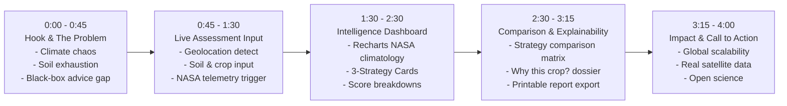

# 14 — Hackathon Demonstration Script & Pitch Guide 🏆
**NASA Space Apps Challenge 2026**

---

## 1. Demonstration Overview & Pitch Persona

- **Time Limit**: 3 to 4 Minutes Live Pitch + 2 Minutes Judges Q&A.
- **Presenter Role**: Lead Architect & Agricultural AI Specialist.
- **Demo Persona**: "Meet Farmer Tariq from the semi-arid breadbasket of Punjab. Tariq has grown wheat and rice consecutively for 6 years. His tubewell water level has dropped 15 meters, his soil is exhausted, and unseasonal heatwaves have cut his wheat yields by 25%. Tariq is asking: *What should I grow next to save my soil and survive with less water?*"
- **Core Value Delivered**: AgriShift turns raw NASA Earth Observations into three clear, explainable, and scientifically validated crop rotation pathways.

---

## 2. Minute-by-Minute Live Demo Script

---

### Step 1: Hook & The Crisis (0:00 – 0:45)
- **Visual**: AgriShift Landing Page (`/`).
- **Spoken Script**:
  > *"Judges, over 500 million smallholder farmers produce a third of the world's food. Yet today, traditional farming calendars are broken. Temperatures are spiking during flowering, rainfall is erratic, groundwater is disappearing, and monoculture farming is exhausting our soil.*
  > *When farmers turn to digital tools, they get black-box advice with zero explanation or generic AI hallucinations.*
  > *Welcome to **AgriShift**—an agricultural intelligence platform powered by NASA Earth Observations, agronomic science, and an explainable hybrid recommendation engine."*

---

### Step 2: Live Field Assessment & NASA Telemetry (0:45 – 1:30)
- **Visual**: Click "Start Field Assessment" $\rightarrow$ Multi-step Wizard (`/assessment`).
- **Action**:
  1. Click **"Detect My Location"** (or select Punjab, Pakistan: Lat `31.5204`, Lon `74.3587`).
  2. Select Soil Type: **"Loam"**; Land Size: **"5 Acres"**.
  3. Select Current Crop: **"Wheat"**; Previous Crop: **"Rice"**.
  4. Select Water Availability: **"Moderate (Tubewell)"**; Season: **"Summer / Kharif"**.
  5. Select Primary Objective: **"Soil Restoration & Fertility"**.
  6. Click **"Generate Crop Rotation Intelligence"**.
- **Visual Feedback**:
  - The screen transitions to an active NASA satellite telemetry view: *"Querying NASA Langley Research Center POWER Project for 30-year agroclimatological records..."*
- **Spoken Script**:
  > *"In under two minutes, Tariq enters his field details. Right now, our backend is pinging the NASA POWER API at his exact coordinates, pulling 30 years of temperature, precipitation, and solar radiation data—never fabricated, never simulated."*

---

### Step 3: Climate Insights & Strategy Showcase (1:30 – 2:30)
- **Visual**: The Dashboard (`/dashboard/:id`) loads with smooth animation.
- **Action**:
  1. Point to **Location & Climate Banner**: Annual Mean Temp `24.8°C`, Semi-Arid Aridity Index, Live NASA POWER Badge.
  2. Scroll to **Climatology Recharts**: Hover over the July temperature curve (`38.6°C` Max) and precipitation histogram (`182.5 mm`).
  3. Point to the **Three Strategy Cards**:
     - *Card 1 (Baseline Continuation)*: Recommends **Cotton** (Score: `77.2`).
     - *Card 2 (Soil Biological Restoration)*: Recommends **Mungbean** (Score: `93.8`).
     - *Card 3 (Water Resilience & Drought Defense)*: Recommends **Pearl Millet** (Score: `89.5`).
- **Spoken Script**:
  > *"Here is Tariq's tailored intelligence dashboard. NASA's 30-year climatology reveals high summer heat peaking at 38.6°C. Our engine uses this data in Stage 1 to eliminate heat-intolerant crops like chickpeas and prevent Solanaceae disease carryover.*
  > *Then, in Stage 2, our weighted scoring engine evaluates 16 surviving crops across climate, water, soil, rotation synergy, and Tariq's goals.*
  > *Rather than a single dogmatic answer, AgriShift delivers three clear pathways: Baseline Cotton for immediate cash familiarity; Soil Restorative Mungbean to fix nitrogen; and Water-Resilient Pearl Millet to beat drought."*

---

### Step 4: Strategy Comparison & Explainability (2:30 – 3:15)
- **Visual**: Click **"Compare Strategies Side-by-Side"** (`/compare`) $\rightarrow$ Modal opens.
- **Action**:
  1. Highlight the comparison row:
     - Baseline Cotton: Net Nitrogen `-35 kg N/ha` (requires synthetic urea); Water: `700 mm`.
     - Soil Restorative Mungbean: **Net Nitrogen `+50 kg N/ha` (Biological N-fixation)**; Water: `300 mm`.
  2. Click **"View Explainability Dossier"** on Mungbean:
     - Show the detailed score breakdown (`Climate: 92, Water: 90, Soil: 98, Rotation: 96`).
     - Highlight the documented limitation: *"Requires Rhizobium inoculum if legumes unplanted for >3 years."*
  3. Click **"Export Printable Dossier"**: Show clean print preview layout.
- **Spoken Script**:
  > *"Tariq can directly compare trade-offs. The Soil Restoration pathway adds 50 kg of biological nitrogen per hectare back into his soil and cuts water usage by more than half compared to continuing baseline cotton.*
  > *Most importantly: **Every single recommendation is explainable.** We show the exact agronomic math, cited FAO guidelines, and acknowledged risks. No black boxes. No false promises."*

---

### Step 5: Impact & Closing Pitch (3:15 – 4:00)
- **Visual**: Return to Landing Page with NASA attribution footer visible.
- **Spoken Script**:
  > *"AgriShift bridges NASA's world-class Earth Observation science directly to the farmers who feed our planet. It works on any device, requires no proprietary hardware, and is built on open science.*
  > *With AgriShift, we are not just helping farmers decide what to plant next—we are restoring soil biology, conserving precious groundwater, and building climate resilience for the next generation.*
  > *Thank you, and we welcome your questions!"*

---

## 3. Anticipated Judges Q&A Defense

| Potential Judge Question | Prepared Technical Defense |
| :--- | :--- |
| **"Why did you build a hybrid engine instead of training an LLM or deep learning model?"** | *"Deep learning models in agriculture suffer from hallucinations and data scarcity. They frequently recommend biological impossibilities—like planting nightshades consecutively or ignoring lethal temperature spikes. Our two-stage hybrid approach guarantees biological safety through hard FAO/USDA agronomic rules in Stage 1, while using multi-criteria weighted optimization in Stage 2 for localized scoring. It is 100% explainable, deterministic, and auditable."* |
| **"What happens if a farmer is in an area with poor internet connectivity or NASA's API goes down?"** | *"AgriShift is engineered with a multi-tiered resilience circuit breaker. If the NASA POWER API times out or the connection drops, our backend immediately engages our verified regional agroclimatic baseline cache. The UI transparently notifies the user with an amber status pill: 'Running on verified regional baseline.' Furthermore, our entire report view is printable for offline field consultation."* |
| **"NASA POWER is 0.5-degree resolution (~50km). Is that accurate enough for farm-level decisions?"** | *"For strategic multi-season crop rotation, 30-year climatological distributions (thermal limits, monsoon timing, solar radiation) are regionally consistent across 50km agro-ecological zones. Hyper-local variations are accounted for by our farmer input layer—where the farmer supplies exact soil texture, current crop history, and water source availability. We combine regional satellite macro-climate with local farm edaphic reality."* |
| **"How do you plan to scale this globally?"** | *"AgriShift is completely decoupled and cloud-native. NASA POWER has universal global coverage over every landmass on Earth. Our crop knowledge ontology is modular and easily expandable to indigenous regional crops. Because we require no hardware installations or proprietary IoT probes, any farmer or extension worker with a smartphone browser can use AgriShift immediately."* |
