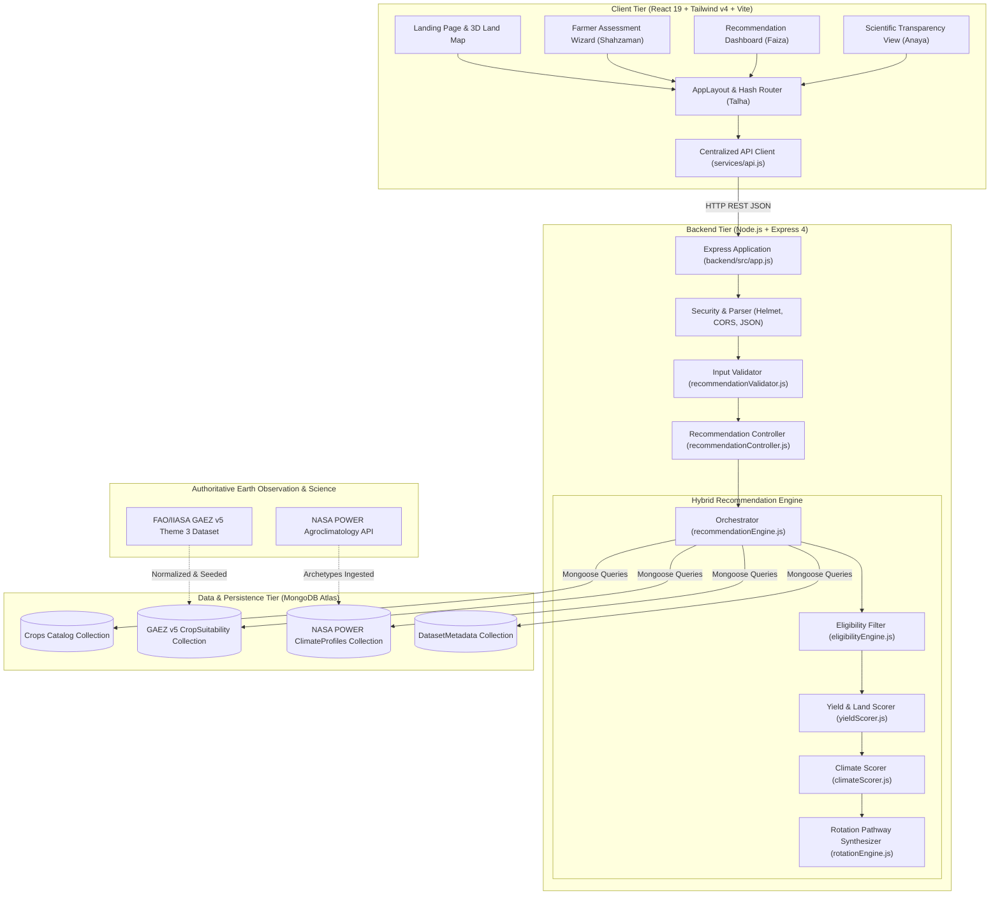
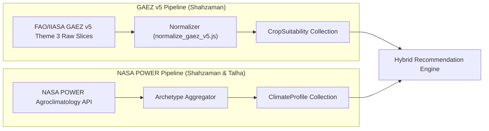
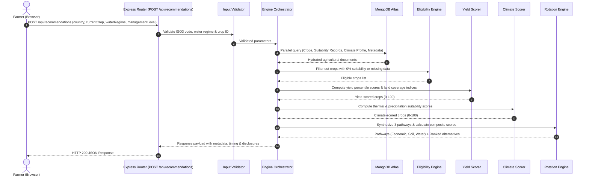
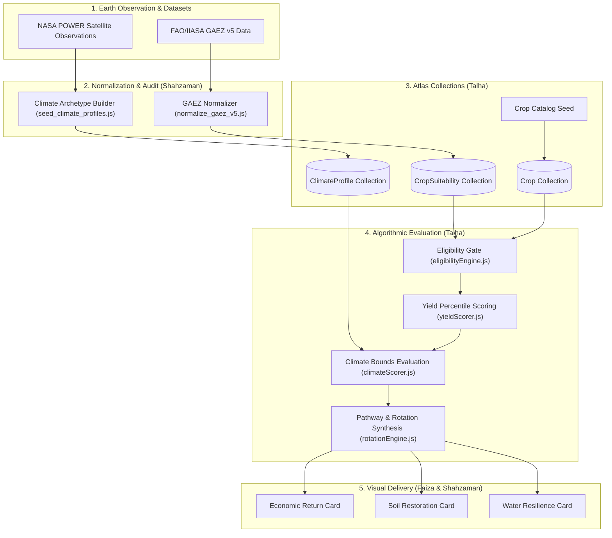

# AgriShift — System Architecture & Technical Specifications

**Technical Lead & System Architect:** Talha (Project Lead & Full Stack Developer)  
**Project:** AgriShift — Global Agricultural Intelligence & Explainable Crop Rotation  
**Hackathon:** NASA Space Apps Challenge 2026  
**Documentation Version:** 1.0.0

---

## 1. Project Overview

**AgriShift** is a full-stack agricultural decision-support platform designed to address climate-induced agricultural dislocation and soil depletion. By coupling **FAO/IIASA Global Agro-Ecological Zones (GAEZ v5)** national attainable yield benchmarks with **NASA POWER** 30-year agroclimatological satellite observations, AgriShift computes explainable, multi-pathway crop rotation transitions for 188 sovereign countries across 8 core rotational crops.

Unlike black-box predictors, AgriShift structures recommendations into three distinct strategic pathways:
1. **Economic Return Pathway:** Maximizes agro-climatic harvest yield potential.
2. **Soil Restoration Pathway:** Breaks cereal monocultures with biological nitrogen-fixing legumes.
3. **Water Resilience Pathway:** Prioritizes drought-tolerant C4 cereals under water-stressed regimes.

---

## 2. High-Level System Architecture



---

## 3. Frontend Architecture

The frontend is housed in [frontend/](file:///d:/Uni%20projects/AgrShift/frontend/) and built on modern web standards:

- **Bundler & Runtime:** Vite 8 with React 19.
- **Styling Engine:** Tailwind CSS v4 using CSS theme variables and Google Fonts (*Plus Jakarta Sans* for headers, *Inter* for controls and body).
- **Client Routing:** Zero-dependency, native hash router (`#home`, `#assessment`, `#recommendation`, `#transparency`) in [frontend/src/App.jsx](file:///d:/Uni%20projects/AgrShift/frontend/src/App.jsx).
- **Universal Layout:** [AppLayout.jsx](file:///d:/Uni%20projects/AgrShift/frontend/src/components/layout/AppLayout.jsx) provides a single persistent frame wrapping [Navbar.jsx](file:///d:/Uni%20projects/AgrShift/frontend/src/components/layout/Navbar.jsx) and [Footer.jsx](file:///d:/Uni%20projects/AgrShift/frontend/src/components/layout/Footer.jsx).
- **Geospatial 3D Map:** MapLibre GL with MapTiler / Esri public satellite imagery and Terrarium DEM hillshading in [Map3DSection.jsx](file:///d:/Uni%20projects/AgrShift/frontend/src/components/landing/Map3DSection.jsx).
- **Domain-Isolated Feature Structure:**
  - `frontend/src/features/assessment/` ([Shahzaman](file:///d:/Uni%20projects/AgrShift/project_division.md#2-shahzaman--agricultural-data-engineering--assessment-wizard))
  - `frontend/src/features/recommendations/` ([Faiza](file:///d:/Uni%20projects/AgrShift/project_division.md#3-faiza--recommendation-dashboard--data-visualization))
  - `frontend/src/features/transparency/` ([Anaya](file:///d:/Uni%20projects/AgrShift/project_division.md#4-anaya--agricultural-research-scientific-validation-transparency-qa--documentation))

---

## 4. Backend Architecture

The server is implemented in [backend/src/](file:///d:/Uni%20projects/AgrShift/backend/src/) following the standard **Route-Validator-Controller-Service** pattern:

```text
backend/src/
├── app.js                          # Express application initialization & routes
├── server.js                       # HTTP server listener & DB connection init
├── config/
│   └── database.js                 # Mongoose connection manager with reconnection
├── controllers/
│   ├── cropController.js           # Showcase crops catalog
│   ├── landingController.js        # Marketing & UI content
│   ├── mapController.js            # 3D viewport configuration
│   └── recommendationController.js # Recommendation orchestrator & catalog endpoints
├── middleware/                     # Common Express middlewares
├── models/                         # Mongoose ORM models
│   ├── ClimateProfile.js           # NASA POWER agroclimatic normal archetypes
│   ├── Crop.js                     # Agronomic profile & botanical catalog
│   ├── CropSuitability.js          # FAO/IIASA GAEZ v5 suitability & yields
│   └── DatasetMetadata.js          # Provenance & scenario tracking
├── routes/
│   ├── cropRoutes.js               # /api/crops
│   ├── landingRoutes.js            # /api/landing
│   ├── mapRoutes.js                # /api/map
│   └── recommendationRoutes.js     # /api/recommendations
├── services/
│   └── recommendation/             # Algorithmic recommendation engine modules
│       ├── climateScorer.js        # NASA POWER thermal & moisture scoring
│       ├── eligibilityEngine.js    # Rule-based threshold gating
│       ├── recommendationEngine.js # Top-level pipeline orchestrator
│       ├── rotationEngine.js       # Pathway synthesis & composite scoring
│       └── yieldScorer.js          # GAEZ attainable yield scoring
└── validators/
    └── recommendationValidator.js  # Request payload schema validation
```

---

## 5. MongoDB Atlas Data Layer

AgriShift persists normalized agricultural and climatological data in MongoDB Atlas:

### Data Models & Collections

1. **`Crop` (`crops` collection):**  
   Contains 8 verified rotational crops (`cropId`, `displayName`, `scientificName`, `category`, `botanicalFamily`, `growingSeason`, `agronomicProfile`: `isNitrogenFixing`, `droughtTolerance`, `waterRequirementRating`).
2. **`CropSuitability` (`cropsuitabilities` collection):**  
   Stores 5,000+ national records derived from GAEZ v5 Theme 3.  
   - Index: `{ "dimensions.iso3": 1, "dimensions.waterManagement": 1 }`
   - Fields: `dimensions` (`iso3`, `countryName`, `cropId`, `waterManagement`), `attainableYieldKgHa`, `suitabilityIndex`, `suitableLandFraction`.
3. **`ClimateProfile` (`climateprofiles` collection):**  
   Stores regional NASA POWER 30-year climatological normal archetypes (e.g. `punjab_indus_basin`, `us_corn_belt_iowa`, `egypt_nile_delta`).  
   - Fields: `archetypeId`, `location`, `monthlyNormals` (`T2M`, `PRECTOTCORR`, `ALLSKY_SFC_SW_DWN`, `RH2M`), `annualSummary`.
4. **`DatasetMetadata` (`datasetmetadatas` collection):**  
   Provenance records verifying dataset timestamps, source citations, and resolution grids.

---

## 6. GAEZ v5 & NASA POWER Data Integration



- **FAO/IIASA GAEZ v5:** Represents agro-ecological attainable yield potential (kg/ha dry weight) based on soil mechanics, terrain slopes, thermal limits, and water regimes (irrigated vs rainfed; high vs low inputs).
- **NASA POWER:** Evaluates whether ambient temperature ($T_{2M}$) and precipitation ($PRECTOTCORR$) fall within the crop's physiological survival and optimal growth bounds.

---

## 7. Recommendation Engine Workflow

The engine executes in 6 deterministic stages within `generateRecommendations()` in [backend/src/services/recommendation/recommendationEngine.js](file:///d:/Uni%20projects/AgrShift/backend/src/services/recommendation/recommendationEngine.js):



---

## 8. The Three Strategic Recommendation Pathways

### 1. Economic Return Pathway
- **Objective:** Maximum harvest biomass and gross economic output.
- **Selection Criteria:** Highest attainable yield ($Y_{\text{attainable}}$ in kg/ha) combined with superior land suitability fraction.
- **Typical Recommendations:** Sugarcane, Maize, or high-yielding Rice under irrigated high-input regimes.

### 2. Soil Restoration Pathway
- **Objective:** Replenish soil nitrogen, interrupt cereal root-rot pathogens, and build organic matter.
- **Selection Criteria:** Prioritizes verified biological nitrogen-fixing crops (`isNitrogenFixing: true`) and botanical family changes.
- **Typical Recommendations:** Soybean or leguminous pulses following exhaustive wheat/rice/maize rotations.

### 3. Water Resilience Pathway
- **Objective:** Guard against irrigation rationing, seasonal drought, and shifting monsoon precipitation.
- **Selection Criteria:** Lowest crop evapotranspiration demand, highest drought tolerance rating (`HIGH` or `VERY_HIGH`), and low precipitation deficit penalty.
- **Typical Recommendations:** Sorghum or drought-hardy pulses.

---

## 9. Composite Scoring Formula

Each eligible crop is scored on a standardized 0 to 100 scale using documented, peer-reviewed weighting factors:

$$S_{\text{composite}} = 0.50 \times S_{\text{yield}} + 0.35 \times S_{\text{climate}} + 0.15 \times S_{\text{rotation}}$$

Where:
- **$S_{\text{yield}}$ (Weight: 50%):** Normalized agro-ecological attainable yield score derived from GAEZ v5 national yield percentiles and suitable land fraction.
- **$S_{\text{climate}}$ (Weight: 35%):** NASA POWER agroclimatological compatibility score evaluating thermal bounds ($T_{\min} \le T_{\text{mean}} \le T_{\max}$) and precipitation deficit.
- **$S_{\text{rotation}}$ (Weight: 15%):** Agronomic rotation diversity bonus.
  - $S_{\text{rotation}} = 100$: Diverse botanical family rotation (breaks pathogen cycle).
  - $S_{\text{rotation}} = 30$: Monoculture continuation (same crop as current).

---

## 10. Data Flow: From Earth Observation to Recommendation



---

## 11. Scientific Disclosures & Limitations

AgriShift enforces strict scientific transparency per the NASA challenge criteria:

1. **Modeled Attainable Yield vs. Real Harvest:** Attainable yields represent agro-ecological potential under optimal management. Actual field yields depend on localized seed quality, pest outbreaks, and timely irrigation.
2. **Sensor-less Soil Fertility Inference:** Soil restoration benefits are derived from biological nitrogen fixation agronomy (Rhizobium symbiosis). AgriShift does not claim direct real-time measurement of in-situ soil N-P-K without physical soil tests.
3. **Macro-Regional Climate Normals:** NASA POWER profiles represent 30-year regional climatological normals. Local microclimates (e.g. frost pockets, valley drainage) should be verified locally.

---

## 12. Local Development & Deployment Architecture

### Environment Configurations

- **Frontend (`frontend/.env`):**
  - `VITE_API_BASE_URL=http://localhost:5000/api`
- **Backend (`backend/.env`):**
  - `PORT=5000`
  - `NODE_ENV=development`
  - `MONGODB_URI=mongodb+srv://...`
  - `CLIENT_URL=http://localhost:5173`

### Build & Verification Commands
```bash
# Backend verification tests
node dataset/scripts/test_landing_api.js
node dataset/scripts/test_common_components.js
node dataset/scripts/test_layout_routing.js

# Frontend production bundle
npm run build --prefix frontend
```
